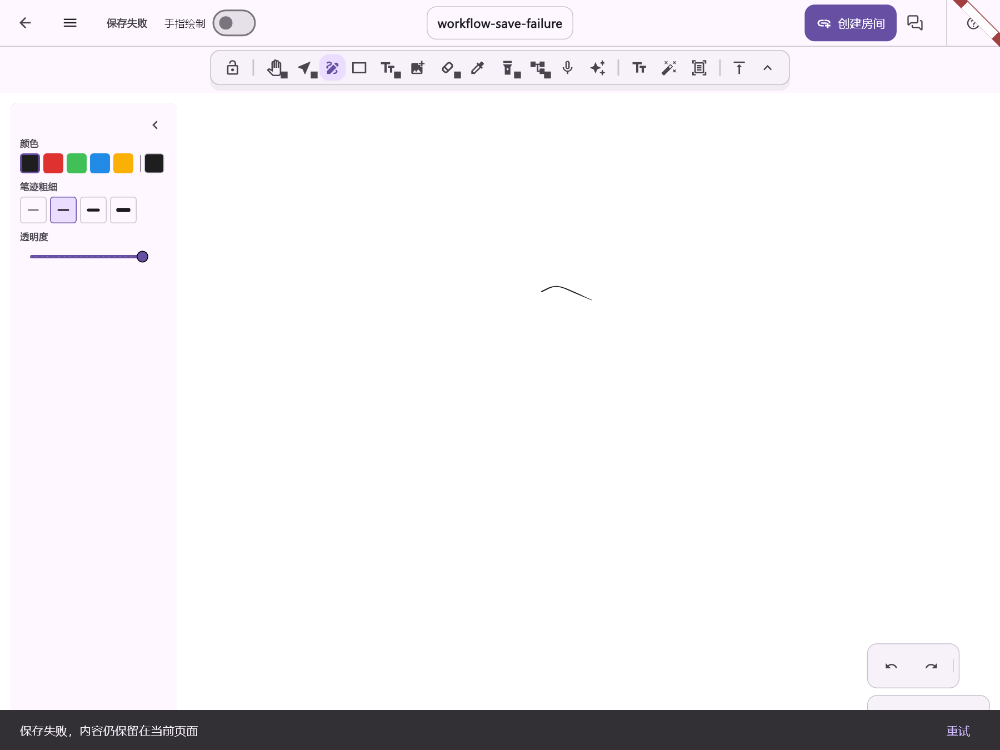

# 保存失败状态截图

`save-failed.png` 来自真实 WhiteboardPage 的 Flutter 组件测试：模拟本地写盘失败，确认笔迹仍在、标题栏显示“保存失败”、底部提示提供“重试”。数据为合成笔迹，不连接账号、生产服务或真机。

来源用例：`FlowMuse-App/test/features/whiteboard/views/whiteboard_writing_workflow_test.dart` 中“自动保存失败保留草稿，退出失败不离页，手动重试可恢复”。截图包装在忽略的 build 目录中临时加入 RepaintBoundary，并显式加载本机中文与图标字体；测试通过后输出 1800 × 1350 PNG。

该截图用于审查保存状态和重试入口，不作为鸿蒙/Android 真机视觉或性能验收依据。完整自动化测试、构建结果与其他已知边界见 `docs/研发记录/plans/2026-10-20-finals-data-integrity.md`。
