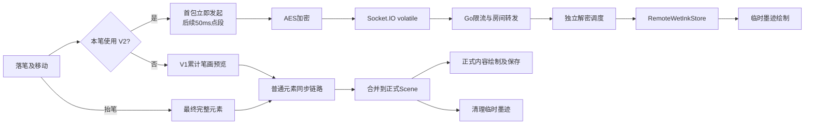

# 协作流畅度与同步完整性优化方案

日期：2026-10-21。分析基线：`fix/collaboration-socket-auth` / `497cc7a`。

状态：已获用户授权实施，分支 `fix/collaboration-fluidity`。以下分析基线保留，实施结果持续追加。

## 1. 结论与目标

用户当前反馈：协作需要等一笔写完，另一端才显示；随后明确确认配套测试 Web 也有同样现象。因此不能用“误入正式 Web”解释整个问题。浏览器与平板的实际运行模式仍需现场数据核对。

**当前代码已经实现书写中同步。优先任务是恢复并验证实时预览链路，然后减少延迟、消除冗余同步，最后补齐确认与修复机制。** 不能把“打开 V2”或“把 50ms 改成 16ms”当作完整解决方案。

把“同步率”拆成三件可以测量的事：

1. **书写中可见率**：足够长的一笔，在抬笔前，对端实际画出了笔迹的比例。
2. **实时可见延迟与覆盖率**：点进入输入管线后，多久出现在对端；书写过程中有多少轨迹及时可见。
3. **最终一致率**：抬笔、删除、撤销、断线恢复后，各端最终内容是否一致，是否漏笔、复活或重复。

实时预览允许丢弃过时帧；最终内容必须可确认、可补偿。不能为了让丢包计数变成零，把过时预览排成长队。

按当前使用方式，以 **Android 平板 ↔ Web 双向书写**为主要验收，5 人同时书写为性能扩展场景。8 个远端活跃发送者是现有接收上限，需要明确验证；9 个及以上先验证有界降级，不能宣传为已支持更大规模。

## 2. 证据与边界

### 2.1 当前部署与验证

| 项目 | 本轮核验结果 | 能说明什么 |
| --- | --- | --- |
| 本地代码 | `497cc7a`，业务代码无未提交改动 | 本方案分析的具体版本 |
| 测试 Web 发布清单 | `live-ink-v2-authfix-20261020-497cc7a`，湿墨分层与 V2 都为 true | 服务端静态发布正确；不能证明浏览器实际加载版本和运行时协商状态 |
| 正式 Web 发布清单 | `main-20260927-393566f` | 正式入口与测试入口不是同一发布；清单未提供两个功能标志，不能由缺失字段推断其值 |
| Android 安装回执 | 2026-10-20 的回执记录 `497cc7a`、两个标志 true | 上次安装证据；本轮未重新读取设备上的实际包 |
| 后端资源瞬时采样 | CPU 0.00%，内存约 5.8MiB | 采样时没有资源饱和；不能排除写入高峰、网络或锁竞争 |
| V2 协作服务与仓库测试 | 87 项通过 | 现有组件、模拟故障和同步语义通过；不能代替跨设备端到端测试 |
| 默认开关测试 | 2 项通过 | 默认仍关闭 V2 |
| Go 协作模块 | `go test ./internal/collab -count=1` 通过 | 包含本地 Socket.IO polling 集成测试；不是线上 WSS + Flutter 的完整路径 |
| 旧 CPU 性能基准 | 失败：`Bad state: Too many elements`，随后交付等待超时 | 有历史元素的旧基准已不适合当前全量同步语义 |

测试选择曾将“构建默认关闭”的断言放进显式开启 V2 的命令，得到 1 项预期不符；拆开运行后分别得到上述 87 和 2 项通过。该失败不作为产品缺陷。

日志位于 `FlowMuse-App/build/collaboration-plan-audit-{v2-tests,flags-tests,cpu}.log`，均为本地构建产物。

此前用户观察到“重启后改善”，说明连接或运行状态值得排查，但没有证明内存泄漏、服务器算力不足或某次代码改动是唯一原因。上一轮 Socket 旧登录凭据修复解决连接鉴权问题，不能视为书写流畅度已修复。

### 2.2 已存在的能力，继续复用

- AES-GCM 端到端加密、Excalidraw 最终元素格式、version/versionNonce 的 LWW 冲突规则。
- V1 活动笔画预览，首次有效移动后尽早发送、后续约 50ms 一次。
- V2 落笔首包、50ms 点段发送、最多 64 点、自包含样式和三个发送周期的重叠窗口。
- 发送侧 1 个执行中任务 + 1 个可覆盖候选；接收侧按发送者保留最新候选、轮转和调度让步。
- 可靠元素的 16ms 固定批次；远端 16ms 合并；已有结构共享和画布局部通知。
- RemoteWetInkStore/Painter、冻结块和渲染缓存、final 到达后清理临时墨迹。
- 失败重试、快照乐观锁、撤销保留远端内容、图片独立传输。
- CollaborationPerformanceProbe、故障注入 transport、CPU 基准和 Profile 入口。

这些能力不重复建设。特别是 **V2 已有独立的应用层发送和解密路径**；后续不能把“新增独立队列”重复算成收益。它仍与普通消息共用底层连接和设备资源。

### 2.3 用户确认测试版同样异常后的补充实验

本轮仅在本机隔离环境复用当前 Go Hub、事件与 HTTP 实现，使用内存测试房间，不访问用户房间、不修改线上数据。诊断脚本和日志放在被忽略的 build 目录。

- 再次读取测试站发布清单：`497cc7a`，两个标志 true；清单 JS 摘要与本地交付产物一致。线上服务二进制包含 `live-ink-ready`、`server-live-ink`、`client-live-ink` 标记，但标记存在不等同于运行时成功。
- 直接使用真实 Dart Socket.IO 客户端和项目 AES/消息 codec，连接本地 Go WebSocket 服务：两端收到版本2确认，10个加密点段全部在普通场景消息发送前收到并解密，错误0。这证明基础格式可以互通，未验证实际画布或线上链路。
- 换成项目实际 `SocketIoRealtimeTransport + CollaborationRepository`，两端显式设置两个开关为 true：重复诊断中，首个客户端 effective=false，后加入者 effective=true；首个客户端未观察到 `live-ink-ready` 解码事件。增加200ms入房间隔后仍复现。
- Go outgoing 事件记录显示已尝试发出两次 ready；Dart Manager 的已解码事件记录只见后加入者的 ready。因此下一步应继续区分服务端排入发送、实际传输与客户端解码，尚不能将原因写成已证实的“协商超时”或“入房时序错误”。
- 实际封装诊断在“双方V2已生效”这一前置断言失败，未完成后续点段/Store验收，不能报告该实验通过。证据：`FlowMuse-App/build/local-writing-tablet-20261020/live-ink-adapter-diagnostic-{2,3,4}.log`。
- 本轮 ADB 未找到此前平板，未读取其实际安装包、运行状态或绘制时延。

该结果提高了任务1中真实传输诊断的优先级。任务2的能力协商修复仍有必要，但 **V1 降级本身并不应自动变成“只见终笔”**，还需要检查兼容预览和实际绘制，不能以这份局部复现宣布用户问题的唯一根因已找到。

## 3. 现有链路与故障定位

如果抬笔后能看到完整笔画，说明至少最终元素链路能工作；尚不能判断预览是在发送前、传输中、解密时还是绘制时丢失。按同一笔的脱敏标识，依次记录：

| 观察结果 | 先检查的位置 | 下一步 |
| --- | --- | --- |
| 输入有点，预览候选为零 | Controller 回调、collaborating、冻结模式 | 检查实际构建和该笔选用 V1/V2 的原因 |
| 候选存在，实际 emit 为零 | capability、writable、sender 候选处理 | 区分未协商、过期丢弃和传输不可写 |
| 客户端 emit 增长，服务端入口不增长 | 实际 endpoint、连接、二进制事件包 | 复现真实 Dart 客户端 ↔ Go 服务端，不用内存 transport 替代 |
| 服务端收到但未转发 | 入房身份、格式、限额 | 按聚合原因计数，不直接扩大限额 |
| 转发有数据，接收帧无增长 | 接收端 transport/volatile 丢弃/断线 | 核对 WSS 或 polling、同连接大包与心跳 |
| 接收帧有增长，解密输出为零 | effective 标志、房间代际、解密校验 | 不放宽密钥或消息格式校验 |
| Store 接受点，paint 不增长 | repaint、裁剪、视口、绘制层 | 用可见测试轨迹和绘制计数确认 |
| 所有环节工作但间隔大 | CPU、GPU、队列等待、带宽 | 对耗时占比最高的阶段优化 |

目前没有这份真实双端分段证据，因此不能宣布已找到用户此次问题的唯一根因。

## 4. 优化任务，按优先级执行

### 1）P0：补齐链路诊断和真实端到端回归

**现状/影响：** 发布标志不等于运行时模式，`send()` 完成不等于对端收到，收到也不等于显示。现有不少性能用例使用 MemoryRealtimeRoomHub，即使全部通过也可能漏掉实际传输故障。

**方案：** 扩展已有 probe 与计数器，记录构建号、实际 transport、当前协商结果、每笔模式、候选/emit/服务端接受/接收/解密/Store 接受/paint 的计数、丢弃原因、队列最老年龄。聚合采样，不逐点打印；不记录用户笔迹、密钥或可还原密文。诊断信息放在测试面板，普通用户只看到简明状态。

先用独立测试房间画一条 3 秒长线，双向确认抬笔前持续显示。扩展现有测试：真实 SocketIoRealtimeTransport → 本地 Go → 接收解密；再覆盖实际 Android 与 Web 的绘制。软件协议测试与真实设备测试分别保留证据。

**验收：** 能解释一笔在哪个阶段失去预览；自动化断言必须发生在 pointer-up 之前，不能只检查最终元素存在。

### 2）P0：修正 V2 能力协商与混合版本降级

**已确认：** `LiveInkFlags.effectiveFor()` 只检查本机两个标志与服务端版本。没有检查房间其他成员是否能接收 V2。接收端也以自己的 effective 值过滤 live 帧。

**具体案例：** A 支持并启用 V2，B 使用未启用 V2 的版本。A 只发 V2 临时点段，B 丢弃它们，A 抬笔后的普通 SCENE_UPDATE 才在 B 出现。该机制可解释现象，但尚未证明就是当前两个设备的实际组合。

**另一个确定边界：** 协商从发送 join 起只等 1 秒；超时后迟到 ready 永远不接收，本次连接持续降级。`accept()` 在校验房间之前就结束接收窗口，错误房间的 ready 也能消耗当前机会。服务端入房包含持久化查询，网络/存储慢时存在超过窗口的可能。

**方案：**

- 最小兼容扩展：复用现有加密 presence 通道声明接收能力，并按 socket 会话维护；未知成员先按 V1 处理，不依据同一 userId 合并两个设备。
- 全员确认能接收 V2 才默认选 V2；混合房间先统一走已有 V1，避免长期同时广播两份笔迹。成员变更后重新判断。
- 分清“本机是否发送 V2”和“本机实现是否可以接收 V2”，避免仅因发送降级而拒收可理解的数据。
- 超时先降级，允许当前有效连接的迟到 ready 恢复下一笔；先校验房间/连接代际，再消费确认。旧连接、旧房间事件必须无效，不能仅靠放宽超时时间。
- 每笔冻结模式，切换默认在下一次落笔生效。旧端中途加入时，已开始的一笔可能只能看到最终内容，此边界明确展示并单独验收；若要求中途加入也立即跟笔，再增加受限兼容预览，不能直接让 V1 部分元素被 V2 误判为 final。

**验收：** V1/V1、V2/V2、V1/V2 双向；ready 延迟 0.5/1.5/3 秒；错误房间 ready；断线、重连、同房再入；新旧成员中途加入。升级后的稳定房间不能持续退化为只见 final。

### 3）P0：让“尝试发送”与“实际交给 transport”一致

**已确认：** LiveInkSender 在调用异步 emitter 之前推进 `_lastSentIndex` 和重叠窗口；底层不可写时 `sendLiveInk()` 静默返回 Future<void>。因此未真正 emit 的候选也被当成已发送周期。

**具体案例：** 连续几个周期不可写，发送窗口仍前移；恢复后旧点已经离开最多 64 点的窗口。首段可缺失，停笔但未抬起时也没有新的输入触发重试。最终元素可以补全，但书写中体验差。

**方案：** 在现有调用链传回明确的本地发送结果，只有实际交给 transport 才推进窗口。保留 1 个最新候选，不积压每个原始事件；可写恢复后有界重试最新候选，设置年龄和频率上限。取消、换房、终笔、断线立即结束过时重试。发送许可只说明本地 emit，不能命名为“已送达”。

优先保证首段和最新笔尖。保留重叠窗口抵抗少量应用层丢帧，但不重传全部过时点段。没有证据前不把 volatile 全改为可靠发送。

**验收：** 连续不可写 100/300/1000ms；首包丢失；暂停移动；首包加密中抬笔；取消和房间切换。候选数量始终有界，恢复后先看到新位置，最终内容不丢失。

### 4）P1：减少周期全量与入房同步风暴

**已确认：** `_startFullSceneSync()` 每 20 秒给房间发送完整场景；`syncAll:true` 已按修复后的语义真正发全量。V1 预览、正式元素和全量任务共享 `_sendQueue`。V2 在应用层分流，但仍共享 Socket.IO 连接，不能绕过已经进入底层的大包。

**已确认：** 每个现有成员收到 new-user 后都发送 sceneInit，而且发送到整个房间。若已有 m 个成员且每份场景约 S 字节，一次加入可能触发约 m 份全量上行和接近 m² 份场景副本的下行总量；这是路径推导，不是当前实测带宽。

**分两步做：**

1. 先保留全量修复兜底，给周期任务增加合并、空闲调度、随机错峰、字节预算和最大延期。保持显式强制同步、撤销恢复与重连同步的正确语义；不能重新用“已经发送过”过滤掉必须重发的元素。
2. 增加加密状态摘要交换：一致时不传完整内容，不一致时请求差异；无法确定或差异过大才回退完整快照。摘要由已提交内容派生并增量失效，不能每 50ms 重算全场景。初期可先整场景摘要 + 全量修复，再按测量引入分组差异，避免一步建设复杂同步引擎。

新成员初始化由一个确定的已就绪成员提供，增加超时接替；新增定向转发需服务端验证发送者与接收者同房。其余成员在初始化后参与摘要校验和差异补齐，防止“选中的提供者恰好缺内容”。已有加密存储快照是兜底，不默认它包含尚未持久化的最新内容。

大批次按序、按字节分块，单个超大元素保留快照路径。实时点段和最终笔画优先于后台修复；限制每轮修复工作，防止永远挤占书写，也防止一直书写导致修复永久饥饿。

**验收：** 静止 5 分钟不再反复广播相同完整场景；1000/5000 元素、连续书写、5 人加入或重连时不出现周期停顿；显式补同步仍能恢复故意丢失的正式更新。不得仅删除 20 秒定时器而不提供恢复机制。

### 5）P1：补齐最终笔画确认、重试与断线收敛

**已确认：** 普通 `send()` 调用 emit 后返回，当前业务没有终笔 ACK/重试闭环；断线后的恢复依赖快照与重发。普通消息区别于 volatile，但不等同于保证送达。Socket.IO 的默认交付语义与额外确认要求见[官方说明](https://socket.io/docs/v4/delivery-guarantees/)。

**方案：**

- 按 ADR-013 复用原生 Socket.IO ACK，为正式元素批次提供接收确认与有界重试；服务端 ACK 明确表示“校验并接受转发”，不声称所有参与者已经画出，更不声称已落库。
- 确认成功后再更新相关发送状态；未确认的已提交内容可从现有本地 Scene/草稿恢复。不要只放在进程内待发列表；沿用保存失败提示，不虚构崩溃时的持久化保证。
- 重试保留原元素版本，利用既有 LWW 保证幂等；不因重试创建新笔画或增加版本。独立元素、删除墓碑、撤销和 redo 都要保留，不能全局“只留最后一条”。
- 用加密 peer 摘要/修复确认端间收敛，区分服务端接受、对端接收和最终一致。正常运行不必让每个点等待每个成员 ACK。
- 重连按连接代际合并恢复任务；成功重入房间后执行一次状态核对，不能只依赖某一个 previous status 恰好等于 reconnecting。
- 原生 Connection State Recovery 只作为后续可测的选项；当前入口没有显式启用。即便启用，也保留恢复失败后的状态对齐，继续执行身份和房间有效性检查。

**验收：** 服务端接受后 ACK 丢失、发送时断线、连续断开恢复、结束房间期间重试、浏览器刷新。最终元素不重复，删除不复活，缺失内容能够补齐；UI 不把网络已连上误称为内容已同步。

### 6）P1：频率与带宽分配，优先笔迹

**现状：** 实时墨迹约 20Hz，光标约 30Hz；多类消息共同消耗连接、序列化和加密时间。单纯将墨迹频率翻倍会增加包数，且未必能改善卡在协商或绘制的路径。

**方案：** 先以上述正确性修复后的 20Hz 为基线，再对照 30Hz。保持首段尽早发起、移动点按窗口聚合、终笔提交不等预览。根据本地可写率、队列年龄和接收端采样反馈，在约 20–30Hz 范围调节；拥堵时先减少光标/视口等状态消息，再减少临时预览频率，保留最终内容。

书写时如能由最新笔迹末端表达位置，可降低重复光标更新；悬停、激光笔、选区和不同工具仍单独处理。别直接去掉所有光标。多发送者按人公平，防止某个高采样设备独占预算。

**验收：** 同场景比较 20/30Hz 的首段延迟、更新间隔、CPU/GPU 和字节数；只有收益稳定且本地手写不退化才保留提频。

### 7）P1：接收、合并与渲染避免放大历史场景成本

**已确认：** V1 每次构造累计笔画并序列化；固定采样速率下，长笔持续发送完整点集会让累计处理量随笔画长度快速增长。仓库增量合并仍有整场景建索引、规范化与排序；HistoryManager 记录远端元素时也重新建整场景索引。

**方案：** 优先让双方可用时稳定走已有 V2 点段路径。对正式单元素更新，先通过 Profile 确认重复扫描占比，再在现有 Scene/Repository 内复用生命周期明确的索引与版本状态，减少同一批次多次扫描；owner 修复、绑定文本、顺序变化仍走完整校验。避免再创建第二套可变 Scene 真源。

远端合并若处理慢，采用与发送端类似的 single-flight + 待合并尾批，保留每个元素的胜出版本和墓碑。已有 V2 解密按人公平与缓存继续使用。

当前远端湿墨使用 repaint listenable，但画布中仍有嵌套绘制层。以 repaint 计数和 GPU 数据决定是否增加独立 RepaintBoundary；不把“已有 CustomPaint”当作必然完全隔离的证明，也不盲目增加大量合成层。只对可见预览做裁剪，正式 Scene 仍完整保留离屏内容。

最终笔画成功落入正式画布后清理临时笔画，避免断一下、双重叠加和重影。保留压力、笔型、natural-media 渲染版本及作者聚焦语义；不改原始采样或降低最终笔迹精度来换数字。

**验收：** 0/1000/5000 元素、32/2048 点长笔、PDF 底图、五种笔型、缩放和聚焦；确认湿墨更新不持续触发全页重建，正式结果与优化前一致。

### 8）P2：清理取消预览、长笔停顿与生命周期问题

**已确认：** 本地取消 V2 只清 sender，没有独立远端取消通知；远端临时墨迹靠约 5 秒不活跃 TTL 清理。用户停笔但未抬起超过 TTL，已画预览也可能暂时消失。最终笔画仍可恢复，但观感容易误认为同步丢失。

**方案：** 复用加密消息机制添加可兼容忽略的取消/活动状态，取消立即清理远端预览。活动续期只在需要时低频发送，不把 TTL 直接改成无限。final、cancel、离房、超限和乱序统一检查，取消后迟到包不得复活。房间结束与关闭页面应释放定时器、订阅和候选任务。

Provider 随账号身份改变可能重建 Repository，而页面存在长期持有的引用；需做登录/退出/切账号生命周期测试，确认旧连接与旧订阅被释放。该项为需实测核对的生命周期风险，尚未据此确认泄漏。

**验收：** 按下后停 6 秒再移动、系统 cancel、切工具、切后台、连续进出房间 100 次；没有常驻幽灵笔迹、旧身份连接或持续增长的任务。

### 9）P2：服务端锁、背压与规模验证

**已确认：** V2 转发的 accept 回调在 Hub 全局 mutex 内执行，回调里调用 Emit。当前普通双人负载下未测得它是瓶颈；多房间负载下可能让一个转发阶段拖延其他房间。

**方案：** 先量锁等待和转发耗时，再缩小临界区或按房间隔离。移动 Emit 出锁必须保留离房/结束房间与转发之间的安全约束，不能以性能为由绕过成员校验。不要先引入 Redis、多实例或分布式总线。

维持 60 帧/秒/连接、300 帧/秒/房间的现有限额，先观察丢弃原因；2–5 人按 20Hz 正常发送不能仅凭配置就归因为限流。为慢接收者采用有界临时数据策略，不能让其拖住全房间；正式内容走可补偿路径。

只记录聚合元数据。压测隔离环境的多房间、慢消费者和 30–60 分钟持续运行，检查内存、连接、goroutine、锁和发送缓冲趋势。一次低 CPU 采样不替代长稳测试。

### 10）P2：后台保存与用户状态

**现状：** 普通/V1 发送会调度约 2 秒空闲快照，30 秒上限；本地自动保存还会序列化、生成封面并刷新索引。它们不应成为每个临时点段的工作。

**方案：** 正式变更驱动保存；临时点段只在内存与绘制层流动。对 V1 兼容路径先识别哪些是活动预览，确认取消和断线语义后再避免无效快照，不能简单取消所有写入。合并未开始的后台快照、按内容 revision 去重，封面放低优先级，保留退出/后台强制保存及失败保留草稿。

普通 UI 显示“实时协作 / 兼容模式 / 网络较慢 / 正在补齐 / 离线保留”等可操作状态。加一个“重新检查同步”入口，走已有恢复逻辑，不能通过清缓存、清笔记或让用户重启服务器恢复。模式和指标详细内容只在诊断入口展示。

## 5. 建议验收指标

以下是**实施目标，不是当前实测成绩**。先在指定设备与固定网络上测基线。P95 表示 95% 样本不超过该值，同时报告 P99、最大值与未显示样本，不能只统计成功接收的帧。

| 指标 | 正常网络目标 | 弱网/恢复目标与约束 |
| --- | --- | --- |
| 抬笔前可见率 | 笔画持续至少 500ms、房间已就绪时 ≥99% | 持续断网不能承诺；恢复后明确显示补齐状态 |
| 首段与后续点到远端可见 P95 | RTT≤80ms、抖动≤20ms 时 ≤200ms；稳定后挑战 150ms | RTT约100ms 时 ≤300ms；更差网络单独报告，不套同一阈值 |
| 连续可见更新间隔 P95 | ≤100ms，正常连续书写不出现无解释的 >300ms 停顿 | 报告最长间断、缺口和恢复耗时 |
| 有效采样点及时可见覆盖率 | ≥95%，沿用既有 Profile 门禁口径并明确采样数 | 丢失、被覆盖和过期样本单独统计，最终由完整笔画收敛 |
| 抬笔到完整结果可见 P95 | ≤300ms | RTT100ms及可恢复拥堵目标 ≤800ms |
| 最终一致 | 标准 1000 笔脚本，最后一次操作后 2 秒内内容一致，漏笔/重复/误复活为 0 | 故障解除后 5 秒内补齐；短断线重入房间后 10 秒内补齐；说明场景体积 |
| 本地手写 | input-to-paint P95 相对同包离线基线退化≤5% | GPU/build/raster 使用设备实际刷新周期预算，60Hz 为16.7ms、120Hz为8.3ms |
| 队列与资源 | 保留已有 live 候选上限；停止输入后迅速清空临时任务 | 30–60分钟后无与历史临时帧数量成比例的内存/任务增长 |
| 背景同步 | 静止5分钟不重复推送相同全量场景；新成员只触发一条主初始化路径 | 保留差异校验与失败接替，不以少发数据牺牲最终完整性 |

跨设备不能直接相减两台机器的墙上时钟。单机阶段耗时使用 Stopwatch；端到端使用校准过且报告误差的时钟映射，或两块屏幕同镜头的高帧率录像。采样标识放在测试用合成轨迹/加密诊断字段中，不暴露真实笔迹。

“最终一致”用规范化后的元素内容摘要验证：ID、顺序、version/nonce、删除、几何、点与压力、必要 customData、文件引用；排除本机视口与在线光标。仅比较元素数、version 总和或现有 32 位 nonce hash 不足以证明内容一致。摘要验证在检查点执行，不放进每次 pointer 回调。

## 6. 测试矩阵与基准修正

### 必测矩阵

| 维度 | 内容 |
| --- | --- |
| 两端组合 | 平板→Web、Web→平板、Web→Web；后续 Windows/鸿蒙兼容回归 |
| 登录状态 | 同账号双端、不同账号、访客；登录更新后重入房间 |
| 协议组合 | 新/新、旧/旧、新/旧；ready 延迟、缺失、错误房间和重连 |
| 操作 | 点触、快速短划、3秒/10秒长笔、停笔未抬、取消、切工具、删笔、撤销/redo、双人同时写 |
| 场景 | 空白、1000/5000历史元素、图片/PDF、多页、视口缩放、作者聚焦 |
| 网络 | 正常；RTT100/200ms；受限上行；应用层预览丢弃/重复/乱序；1/5/15秒断线 |
| 压力 | 2/5人并发、8个远端发送者边界、9+降级、成员连续进出、长稳运行 |

区分“注入20%的应用预览帧丢失”和“网络20% TCP包丢失”。后者会触发底层重传和队头阻塞，不能用前者的通过结果代替。

### 先修基准，再谈性能收益

旧 fixture 使用 `broadcastScene(syncAll:true)`，但接收端对 `message.elements.single` 取版本。当前全量发送包含历史元素，因此在 background=1000 时必然不再是单元素；本轮已复现失败。

将基准分为两个已有目的清晰的场景：增量更新按目标 ID 检查并走增量入口；完整修复单独测全量字节与耗时。保留正常批次延迟的端到端测量，另列只测 CPU 的入口，不能把绕过16ms窗口的时间当作用户可见延迟。

每组至少3轮，统一设备、场景、模式、网络和预热；不与构建/全量测试并行跑性能测量。记录所有轮次和失败样本。继续复用现有工具，不另建通用压测框架。

## 7. 实施顺序与提交粒度

| 阶段 | 内容 | 交付门槛 | 粗略工作量 |
| --- | --- | --- | --- |
| A | 任务1：诊断、基准修正、实际链路复现 | 指出预览丢在哪一段，有抬笔前断言 | 0.5–1.5人日 |
| B | 任务2、3：协商/兼容、发送候选修正 | 新版双端持续实时显示；旧端有明确兼容行为 | 1–2人日 |
| C | 任务4第一步、6、7中证据支持的部分 | 长笔与大场景延迟改善，不影响本地书写 | 1–2人日 |
| D | 任务4摘要修复、5确认与收敛 | 故障测试最终一致，周期全量可安全减少 | 2–4人日 |
| E | 任务8–10及实际多端/长稳回归 | 无幽灵笔迹、资源积压和保存回归 | 1–2人日以上 |

工作量为单人熟悉项目时的估算，主要受复现和设备测试影响。决赛时间紧时先完成 A/B/C；不能把 D 的可靠性工作写成已经解决。

建议每个独立问题一个提交：诊断与基准 → 能力协商 → 发送结果和候选 → 周期修复调度 → 终笔确认 → 初始化定向同步 → 有证据的渲染优化。每次保持可构建，提交描述说明触发条件、行为和测试。协议变更单独提交并带新旧端兼容测试。

已从鉴权修复基线派生性能分支，保留 `497cc7a`，按独立问题逐次提交。

### 实施记录：WebSocket批次丢包根因

已通过逐层观测确认：`engine.io/v2 v2.5.0` 的 `transports/websocket.go` 在成功写出 `WsPreEncodedFrame` 后执行 `return`，跳过同一批次后续消息。房间列表广播使用预编码路径，随后的ready、普通消息或二进制附件都可能丢失。该缺陷同时影响已连接客户端的消息完整性，不限于V2确认。

已保留原MIT许可证并本地固定该依赖，唯一行为改动为成功分支 `return` → `continue`，错误处理不变；Docker依赖阶段同步复制本地模块。回归测试在原依赖下稳定丢失4包中的第2包，修复后连续5轮通过。Go全量测试与vet通过。

同一份真实Dart协作封装诊断在修复前 effective=[false,true]、在修复后=[true,true]，10个点在发送正式元素之前全部到达RemoteWetInkStore，解密错误为0。此为本机跨语言验证，仍需线上与实机复核。

## 8. 发布与回滚

- Android 与 `/wet-ink-v2/` Web 同源提交、同功能配置、发布清单一致；实际运行显示简短构建标识与协作模式，不能只核对文件存在。
- 对会新增 ACK、capability 或定向转发的服务端扩展，先兼容发布服务端，再更新测试客户端，最后决定是否推广正式站点。
- 保留原 APK、原测试目录与发布清单；Android 覆盖安装保留数据，不卸载/清库。Web 路径刷新不依赖清掉用户笔记数据。
- 模式回退作用于下一笔或新会话；保留最终完整元素、删除墓碑、加密和保存失败保护。旧版本不能理解的可选消息可忽略，不能破坏基础 SCENE_UPDATE。
- 不使用重启后端作为性能验收步骤；测试须包含持续运行与重连前后的结果。
- 共享代码不加入平台判断，六端保持相同最终数据语义。涉及 H10 冲突/同步实现时，在后续 PR 记录责任人与审查人（人工待指定）及测试证据。

## 9. 暂不采用的路线

- 不重写为 CRDT、不替换整个 Socket.IO，不优先引入 WebRTC、Redis 或多实例。
- 不靠扩大限流/消息上限掩盖拥堵，不把所有临时墨迹改成无限可靠排队。
- 不先把发送频率改为60/120Hz，也不通过丢压力、减少最终点数降低质量。
- 不对 AES 密文做常规压缩来期待明显收益。若确认快照带宽是瓶颈，另评估加密前压缩的兼容与安全边界。
- 不默认迁移小包加密到 isolate/worker；已有异步接口不代表 CPU 在后台，是否迁移由实际阶段占比决定。
- 不用预测线冒充已同步的笔迹。插值/短时显示平滑只有在实测仍有可见跳动时才评估，且不能改变正式坐标。

## 10. 代码与资料索引

下列行号对应本次基线，后续实现会变化。

| 位置 | 证据/用途 |
| --- | --- |
| `FlowMuse-App/lib/features/whiteboard/editor_core/src/ui/markdraw_controller.dart:2388,2458,2590,2684,2943,2962` | 每笔模式、落笔首包、move节流、up最终提交 |
| `FlowMuse-App/lib/features/whiteboard/views/whiteboard_page.dart:2023,2028,2033,2093` | V1/V2页面到仓库连接 |
| `FlowMuse-App/lib/features/whiteboard/collaboration/config/live_ink_flags.dart:9` | 本机标志+服务端版本 gate |
| `FlowMuse-App/lib/features/whiteboard/collaboration/services/realtime_transport.dart:200` | 1秒协商窗口与状态复位 |
| `FlowMuse-App/lib/features/whiteboard/collaboration/services/socket_io_realtime_transport.dart:36,406,433` | writable、普通emit、live丢弃 |
| `FlowMuse-App/lib/features/whiteboard/collaboration/services/live_ink_sender.dart:89,135` | 候选和发送窗口提前推进 |
| `FlowMuse-App/lib/features/whiteboard/collaboration/repositories/collaboration_repository.dart:390,469,517,792,831,950,1179,1357` | 全量语义、发送队列、接收gate、new-user广播、快照和20秒全量 |
| `FlowMuse-App/lib/features/whiteboard/collaboration/services/live_ink_receive_scheduler.dart:20` | 8发送者候选、公平调度和2ms让步 |
| `FlowMuse-App/lib/features/whiteboard/collaboration/services/remote_wet_ink_store.dart:155,292` | 资源上限、TTL、final与清理 |
| `FlowMuse-App/lib/features/whiteboard/editor_core/src/ui/editor_canvas.dart:453,469` | 本地/远端湿墨绘制接入 |
| `FlowMuse-App/lib/features/whiteboard/editor_core/src/rendering/remote_wet_ink_painter.dart:183` | repaint与已有缓存 |
| `FlowMuse-App/lib/features/whiteboard/editor_core/src/core/history/history_manager.dart:25` | 远端历史保护及全场景索引 |
| `FlowMuse-Server/internal/collab/hub.go:222,248,284,360` | ready、限流校验、锁内转发和普通消息 |
| `FlowMuse-Server/cmd/flowmuse-collab-server/main.go:144` | 心跳和8MiB限制，未显式启用CSR |
| `FlowMuse-App/integration_test/fixtures/collaboration_scenarios.dart:196,229` | CPU基准旧单元素假设 |
| `FlowMuse-App/integration_test/collaboration_live_ink_perf_test.dart:176,266` | 既有目标与内存transport边界 |

复用既有计划：`2026-08-20-writing-performance-p3-live-ink-v2-execution.md`、`2026-09-23-collaboration-writing-performance.md`、`2026-09-23-collaboration-responsiveness-phase2.md`。其中旧基准数字与旧测试数量不充当当前版本成绩。

外部语义核对：[Socket.IO交付保证](https://socket.io/docs/v4/delivery-guarantees/)、[volatile与ACK](https://socket.io/docs/v4/emitting-events/)、[连接恢复及恢复失败兜底](https://socket.io/docs/v4/connection-state-recovery/)。具体实现还核对了本地锁定的 Dart 客户端包 socket_io_client 3.1.6 与 Go Socket.IO v2.5.0 相关代码，不能直接照搬 JavaScript 配置假定跨语言行为相同。

未完成的验证：当前用户房间的实际链路复现、真实双端抬笔前绘制时延、物理设备GPU及长稳压测；因此方案中的根因候选和性能目标均不能作为修复已生效的承诺。

## 11. 本轮代码交付与验证（2026-10-21）

- 服务端预编码广播批次截断已修复；真实 Dart Socket.IO → Go → RemoteWetInkStore 链路验证：双端能力确认，10个点在正式元素发送前到达，正式元素确认通道通过，解密错误0。
- 删除1秒硬协商截止；隔离旧连接确认。成员能力在端到端加密消息中交换，未知/旧端在场时下一笔使用兼容预览；新端接收V2的能力不随发送模式关闭。
- 预览发送只在transport接受后推进窗口，保留一个在途与一个候选；50ms重试、250ms候选过期。正式内容通过原生ACK有限重试；ACK仅代表服务器接受转发。等待期间复用ChangeAccumulator已有的在途互斥及按元素合并，保留独立删除墓碑；移除了仓库层重复的可靠候选队列。
- 新版每20秒交换完整内容SHA-256摘要（规范化JSON、包含墓碑和未知customData），不再无条件全量；不一致时600ms合并修复。旧端/未知端继续全量兜底。当前采用有界全量修复，并未引入向量时钟或逐元素补洞协议。
- 新成员由现有成员中socketId排序最小者提供初始化，服务端验证目标同房间后定向转发；加密载荷内也标记目标，兼容旧服务端广播。
- 增加可靠取消消息、停笔未抬每秒单点活动帧、后台快照刷新和恢复前台校验。协作菜单增加检查同步，状态显示实际模式与测试构建标识。
- Flutter全量1817通过、5项既有跳过；静态检查No issues found。Go全量和vet通过。定向同房间/跨房间隔离回归连续3轮通过。旧基准的历史场景单元素假设已修正，公共规范化函数通过已有架构边界测试和指纹测试18项。

### 本机CPU复核

独占测量，2/5成员，1000历史元素，每轮10次预热、50次测量，各3轮。所有轮次errors=0且最终收敛。2人流水线P95分别20.827/20.067/20.582ms；5人23.039/22.675/21.761ms。含16ms批次窗口，使用内存传输，不含真实网络、远端绘制和设备GPU；不是平板延迟成绩，也不与旧绕过窗口的数字直接比较。

发送频率维持20Hz。没有证据支持现在改30/60Hz、迁移加密worker、重写渲染或扩大服务端锁优化，因此未引入这些改动。2/5人实机、受限网络、断线1/5/15秒、长稳运行和GPU验收尚待用户设备接入；用户明确先完成代码和Web，自行体验测试。H10责任人：本轮实现者；人工审查人：待指定。

补充：正式更改在等待网络ACK之前即标记快照为脏，切后台显式刷新不再依赖网络确认先完成；临时预览不单独触发快照。新增阻塞发送期间保存与预览触发隔离回归。

### 发布回执（2026-10-21）

- 代码发布基线：`2a39652a0ecd6f3f52b257c97c347deb6ee15683`，测试Web显示构建ID `2a39652`；湿墨分层与实时墨迹V2均启用。
- 最终全量复测1818通过、5项既有跳过；analyze无问题。并行Web构建时静态绘制性能门禁曾出现ratio=3.03的超线样本，未改动阈值；独占复核ratio=2.96通过，停止构建后的全量复核ratio=2.73通过。不得将这些debug CPU数字当作设备帧耗时。
- 测试Web：[入口](https://app.flowmuse.cloud/wet-ink-v2/library)，[发布清单](https://app.flowmuse.cloud/wet-ink-v2/flowmuse-release.json)。main.dart.js SHA-256：`33a65101984c2faaeb8bdc6e985eb610f2ebd886e5b9b9d426d4538d7f248007`；已公网回读匹配，SPA深链接通过。正式Web前端仍为`main-20260927-393566f`。
- 后端镜像：`flowmuse-collab:fluidity-eb6d365`，镜像ID：`sha256:1af39d9f7003b9c506ca6361dfa7c37adc24802a89e557fc57794ae4e490673b`；Linux二进制由Go1.25.6从本轮代码交叉编译并校验SHA-256，沿用alpine:3.22运行层，避免在生产小内存主机编译。
- 服务端环境变量逐键值核对、端口保持；旧镜像保留为`flowmuse-collab:before-fluidity-20261021`，回滚覆盖配置位于`/opt/flowmuse/releases/collaboration-eb6d365/rollback.override.json`。首次校验曾将变量排列顺序误判为变化，自动回滚后修正为键值比较，第二次发布通过。公网`/health`与Socket.IO Engine.IO握手正常。
- Nginx测试路径根目录为`/var/www/flowmuse-collaboration-fluidity-20261021`，备份为`/etc/nginx/sites-available/flowmuse-app.before-collaboration-fluidity-20261021`。只切换测试前缀，正式前端根目录保持。
- 尚未覆盖安装平板；ADB当前无设备。真实用户房间绘制、GPU时延和长稳验收由后续配套设备测试完成。

- Android ARM64配套测试包已构建，源代码/构建ID同Web：`2a39652`；APK SHA-256：`724773a624bd7d6a4672caa907a4f028a4495f32918d79eca547012018ae9c99`，179297442字节；9个原有ARM64原生库齐全，构建ID已在libapp.so核对。apksigner验证通过，证书SHA-256与原安装包一致：`e67952adb86936a9f49406c274f92ee65c35d2706f91dd19436eeaf2b8072ecf`。APK和机器可读回执留在忽略的build目录，未卸载/清理用户数据，也尚未安装。
- 后端运行的Compose覆盖配置为`/opt/flowmuse/releases/collaboration-eb6d365/deploy.override.json`。后续维护需继续同时指定原compose与该覆盖配置；在正式源码部署更新前，单独使用旧源码目录的默认构建会回到旧服务端实现。

### CI依赖一致性修复

Smart Layout V3 CI及三宿主Platform流水线原先没有配置锁文件对应的PUB_HOSTED_URL，也没有--enforce-lockfile；此次触发后将objective_c从已锁定9.4.1漂移到pub.dev的9.6.2，其build hook使用了本项目固定code_assets API中不存在的Architecture.arm64e，四个job同样在测试开始前失败。两组流程现与Quality保持镜像源及强制锁文件一致，并将pubspec和本地code_assets变化加入触发范围。没有升级/降级客户端依赖，也没有改变已发布Web和APK的代码或依赖。
