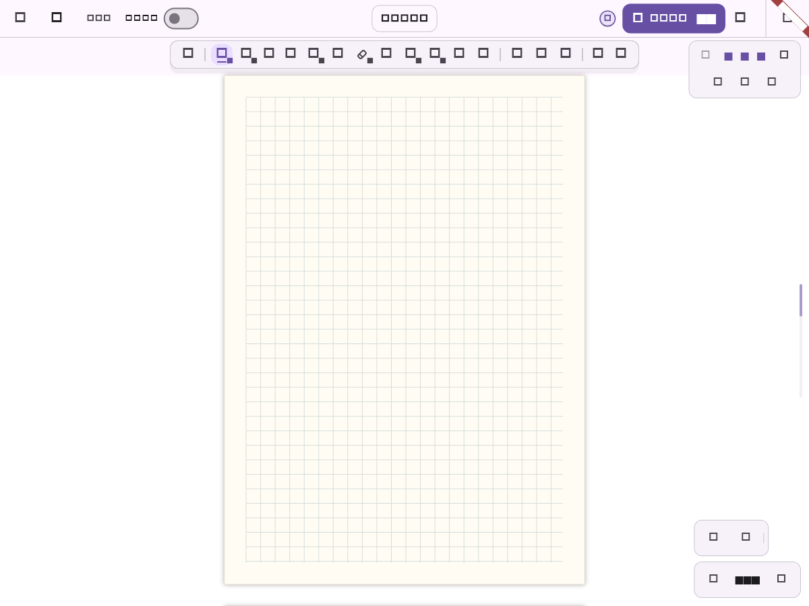

# Issue #65：协作画布版式一致性

## 范围与现状

- 房主与加入方应使用相同的有限画布、页面模板和排列方向；加入方保存到本地后重开仍应一致。
- 当前页面标记已通过 `elements[].customData.flowMuse` 同步，包含页面尺寸、模板、方向和来源；优先复用，不新增协作消息、快照格式或服务端分支。
- 核查加入空房间时跳过应用场景、页面模板仍沿用本机默认值、临时协作保存时默认创建无限笔记这三处缺口。
- 用户补充加入端为安卓平板。页面测试复现默认 1 倍缩放下只能看到首张纸内部，四边不能完整显示；加入时先适合首张纸，使有限画布边界可见。只调整本机初始视口，后续同步不重新缩放。

## 实施与验证

1. 用真实白板页面和内存协作仓库覆盖有限房间加入、模板和方向、继续插页、保存到本地和重开；先确认失败位置。
2. 在已有页面标记恢复逻辑中补齐默认模板/方向；加入房间时采用房间场景，避免空场景保留本机版式；保存临时协作时沿用当前版式创建笔记。
3. 回归旧页面标记、PDF 背景、无限房间与增量页面更新；运行相关测试、全量 Flutter 测试、静态检查和 Web 编译。

## 边界

不改实时墨迹、元素冲突规则、加密、分批补偿、数据库或后端性能路径。旧版本若完全没有页面标记，接收端无法凭空推断房主本机笔记设置；需要房主用新版重新打开笔记并创建房间。

## 复现证据

- 原有页面标记可恢复 `paged` 类型；未复现内部类型直接丢失，但平板尺寸下首屏缺少完整纸张边界的断言在空白、网格和古籍三种模板上均失败。
- 原版恢复 10 种非空白模板时默认模板均为 `blank`；乱序页面标记不能稳定恢复阅读顺序对应的默认版式。
- 本机有限笔记加入零元素无限房间，原版仍保持 `paged`，与房间场景不符。
- 新增真实页面流程覆盖临时协作的加入、首屏边界、继续插页、保存到本地和重开；不能把自动化结果等同于安卓真机验收。

## 自动化验证

- 新增 16 项回归：11 种模板分别经全场景和增量恢复、标记乱序及旧字段兼容、3 种模板的真实页面完整流程、加入空白无限房间。
- `flutter test --no-pub --reporter expanded`：1841 通过、5 跳过（原有跳过）；包含 PDF、撤销、归属、外部导出净化与协作补偿的既有测试。
- `flutter analyze --no-pub`：无问题。
- 代码和自动化核查覆盖远端场景 UI 应用；未改 LWW、墓碑、customData 深拷贝、加密及导出净化。H10 人工责任人/审查人待项目组指定，安卓双端实际效果尚未验收。

## 构建与交付状态

- 应用代码提交：`be71e89a39a869d3cdeefc9780fa86dd5fc23620`，分支 `fix/collaboration-canvas-layout`。
- 与当前增强配置一致，开启 `FLOWMUSE_LAYERED_WET_INK=true`、`FLOWMUSE_LIVE_INK_V2=true` 时，完整书写流程文件 17 项全部通过。
- Web release 构建通过：`FlowMuse-App/build/issue65/web`；`main.dart.js` SHA-256 为 `1a320746063cd57a26009a7f68ef432a454764d0bb1bb8a1f1a19b9ec9131b7c`。
- Android ARM64 release 构建通过：`FlowMuse-App/build/issue65/flowmuse-canvas-layout-be71e89-arm64.apk`；SHA-256 为 `6ec0d7530d55ee00bf2411223b6ad998b9a53c47a8ba322c6dbd785b2d35a5e0`。已验证构建标识、原生库 ELF 架构、与原安装包一致的引擎及签名；用户表示安卓包不着急，保留本地产物。
- 构建回执：`FlowMuse-App/build/issue65/artifact-receipt.json`。本轮未部署线上 Web、未改后端、未安装平板；ADB 当前没有设备。Issue #65 保留开放，等待安卓真机复测确认实际现象消除。

## 页面显示证据

下面是 1200×900 自动化场景中加入网格有限画布后的实际渲染，显示首张纸的范围。文字和图标使用测试字体，不代表正式版本字体，也不作为安卓真机验收。

