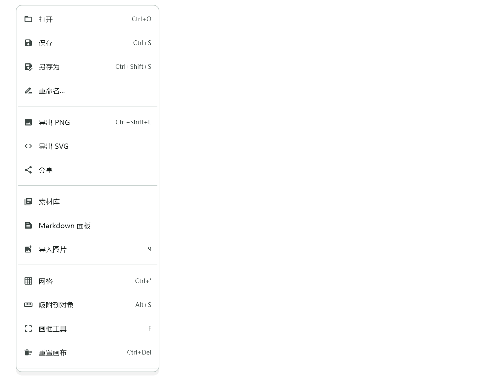
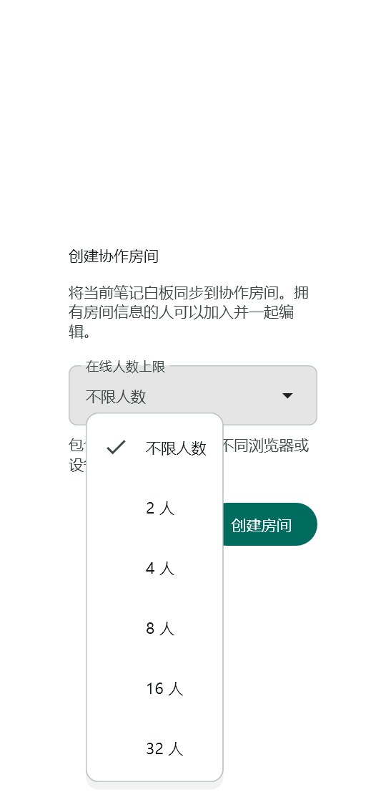
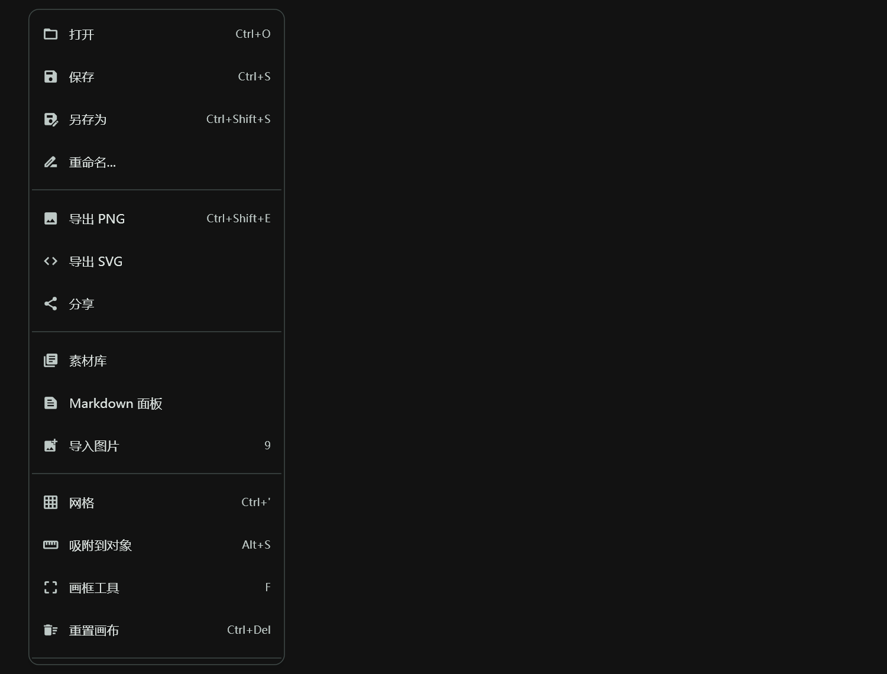

# 统一锚点面板审查与 Web 发布

## Context

审查分支 `feature/ui-anchored-panels`，起点 `72b51b5`，基于 `main/a859001`。本轮按用户要求审查、修复、提交 PR，并将该分支部署到正式 Web；不自动合并 PR。

## 需求与范围

保留原分支的纸面菜单、下拉选择器及方向性动画设计，检查所有公共入口与调用方。修复左侧定位、动画坐标、安全区域/软键盘避让、局部主题继承及异步选择生命周期；验证键盘与触感失败容错。仅修改共享 UI 与必要调用方，不改白板数据、协作协议、后端或原生平台代码。

## 实施与验证

先补充回归复现，再修复公共组件。运行共享面板、UI 生命周期、协作建房、设置、社交和排版相关测试，然后静态检查与全量测试。构建正式配置 Web，在隔离的本地浏览器中检查菜单、下拉框、窄屏并留存不含真实笔记的截图。

提交修复与验证文档并创建 PR。部署使用独立版本目录、保留原 Nginx 配置与旧版本，检查资源哈希与线上版本；保持既有 API、分享域名、湿墨分层和实时墨迹 V2 配置。记录实际验证与未覆盖范围。

## 审查与修复结果

- 新增回归在修改前复现 6 处缺陷：左侧定位仍右向弹出、负坐标越界、局部主题未作用于纸面、缩放错误作用于整屏、触发器销毁后回调旧页面、无回调的下拉框仍可展开。
- 修正公共布局的左右对齐与安全区/软键盘约束；将缩放淡入及菜单语义移入面板自身，避免整屏坐标漂移和透明阶段的空菜单语义。
- 在捕获的主题内构建容器；异步选择检查挂载状态，补充本地化关闭屏障语义，触感系统不可用时记录异常类型并降级。
- 方向键选择、Escape 关闭、减少动画、窄屏长列表滚动以及原有菜单选择/取消回归通过。
- 相关页面与共享组件 40 项测试通过；静态检查无问题；全量 1894 项通过、5 项既有跳过，无失败。日志位于本地忽略目录 `FlowMuse-App/build/anchored-panels/`。

## Web 构建与可视验证

- `8a20fd4` 完成正式 release Web 构建，API 与分享域名使用正式地址，湿墨分层、实时墨迹 V2 保持开启，CanvasKit 自托管。
- 隔离 Chrome 测试会话打开空白资料库，桌面菜单选择切换视图、360px 窄屏打开菜单及 Escape 关闭全部通过，页面运行错误为 0。未登录账号或访问真实用户笔记。测试等待菜单可交互后再操作，避免将展开动画期间的键盘事件误判为卡死。
- 使用真实汉堡菜单、建房对话框及生产主题生成桌面、360px 窄屏、夜间预览；截图仅使用空白/合成内容，已检查中文、边界和滚动。组件截图的中文字体替换只用于测试渲染，不修改生产字体配置。
- 本轮未重新构建或安装移动端，也未进行平板真机验收。PR 保持待审；Web 按用户要求发布该分支版本，部署回执保存在本地构建目录。

