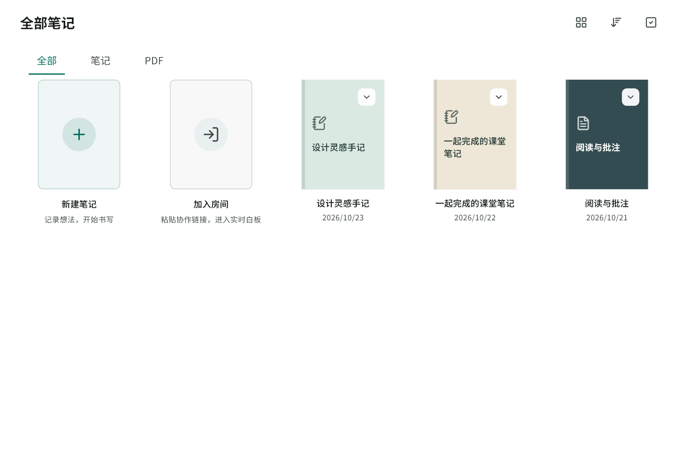
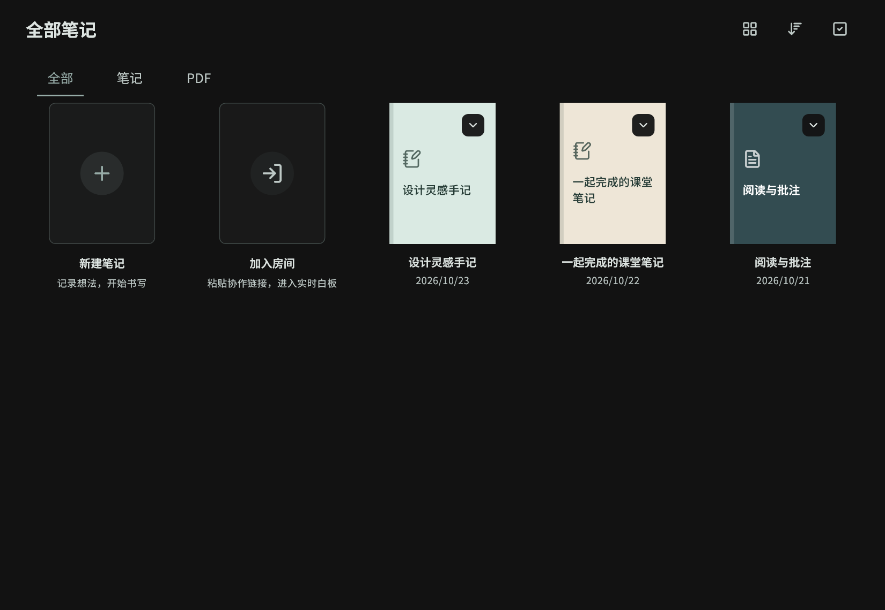
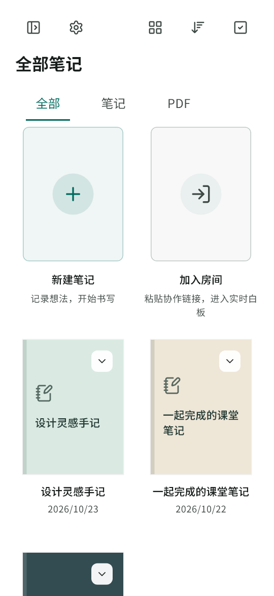
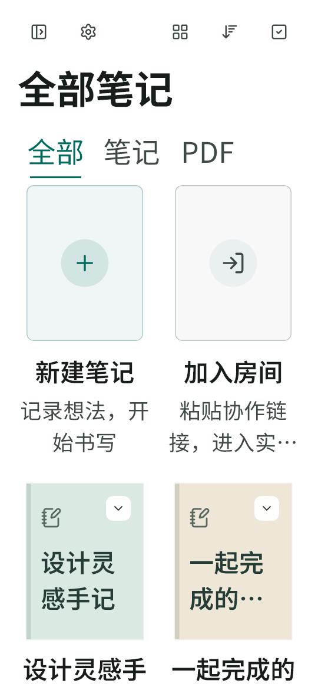

# 第一轮视觉与动画优化

## Context

用户确认实施第一轮：视觉细节修复、字体与信息层级、首页卡片与空态、动画节奏统一。基于 `feature/ui-anchored-panels/54a8234` 新建 `feature/ui-polish-round-one`，保留上一轮待审 PR。

## 范围与设计

沿用青绿、纸面和克制阴影。复用 AppTheme、AppSpacing、RightPageHeader、NoteCard 与现有空态；不修改协作协议、书写渲染、数据库、原生平台或编辑器内容字体。

1. 修复深色标签对比度；紧凑页头将操作区与标题分行，放大按钮触控区域，并覆盖大字号。
2. 引入随应用分发的开源中文 UI 字体及许可证，明确正文、页面标题、对话框与辅助信息层级。字体仅应用到界面；用户白板字体保持原语义。
3. 无缩略图或解码失败时展示有颜色、书脊与标题的封面；更多操作提供足够触控范围；空资料库突出新建与加入房间，空态支持滚动。
4. 集中管理常用动画时长，协调页头、侧栏、标签与路由；保留减少动画偏好，不给墨迹增加动画。

## 关键文件

`app/app_theme.dart`、`app/app_router.dart`、`shared/widgets/{app_spacing,right_page,app_shell,shared_sidebar}.dart`、资料库卡片/内容与集合视图，及镜像测试。

## 验证与提交

先运行相关既有测试；补充夜间标签、窄屏/大字号页头、封面回退与操作点击、空态入口、减少动画的行为回归。完成静态检查、全量测试、release Web 构建和日间/夜间/窄屏截图检查。按布局与卡片、字体与动画、验证文档分批提交；记录实际覆盖范围，不将构建通过视为真机通过。

## 实施结果与验证证据

- `40e3a0f`：页头在窄屏/大字号下分行，页头与笔记更多按钮保留 48px 触控范围；夜间筛选使用主题色，封面缺失/损坏时回退为彩色纸面，卡片高度随字号调整，复用空态的新建与加入入口。
- `1f1bb76`：统一界面字体与排版，收口界面动画时长及减少动画；空态区分加载和分类，正文、页面标题、对话框与辅助信息建立字号和字重层级。未修改协作协议、墨迹渲染、数据库或白板元素字体。
- 字体使用 Noto Sans SC 的固定上游版本，裁剪并重命名为 FlowMuse Sans，保留版权/OFL；400/600/700 三份静态字体总计约 7.1 MB。生成脚本检查源文件 Git blob、实际字重和字符覆盖。罕见字符继续回退，不限制用户输入。
- 修改前相关基线 38 项通过；新增 8 项回归覆盖窄屏、大字号、触控边缘点击、封面回退、加载/空分类、深色标签和减少动画。全量 **1902 项通过、5 项既有跳过**；`flutter analyze --no-pub` 无问题。
- 两处既有壳层测试原先用标题文本次数统计笔记；改为核对实际卡片与 PDF 筛选结果，并显式推进页面动画首帧与结束帧。没有删除测试或放宽为“任意数量”。
- `flutter pub get --enforce-lockfile` 成功，锁文件无变更；`1f1bb76` release Web 构建成功（53s），保留正式 API/分享域名、湿墨分层和实时墨迹 V2 配置，CanvasKit 自托管。
- 隔离 Chrome 验证桌面菜单切换、360px 窄屏菜单及 Escape 关闭、新建配置页打开/取消、加入房间弹窗打开/取消通过。三档 UI 字体均从本地构建资源返回 200；页面运行错误为 0。仅使用新的本地浏览器会话，未登录、未创建或加入真实协作房间。
- 真实生产组件使用合成笔记生成下列预览，另检查空库和 200% 字号。测试与构建日志、浏览器验证回执保存在忽略目录 `FlowMuse-App/build/ui-polish-round-one/`。

本轮未推送远端、自动合并或部署。没有构建/安装安卓或鸿蒙包，未做平板真机或 GPU 帧耗时测量；动画时长统一不代表已实测帧率提升。上一轮 PR 保持独立。

