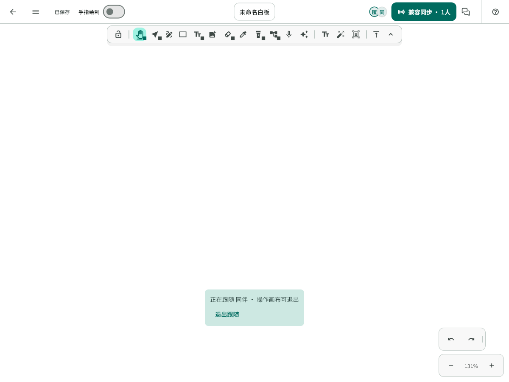
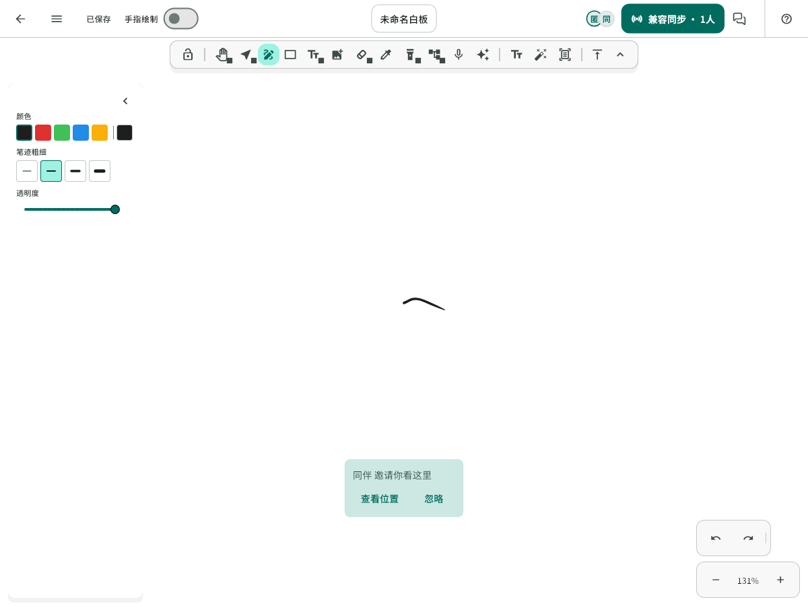
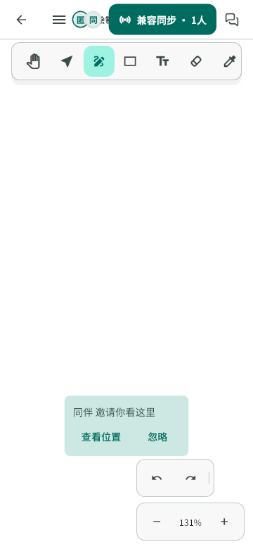

# F1：协作感知、查看位置与视角跟随

## Context

基线 `main/46ef595`，分支 `feature/f1-collaboration-awareness`。用户同意先实现协作感知与视角协同，权限作为独立设计项。此前未提交的决赛计划 v1.1 和文档导航一并保留在该分支。

现有链路已经同步光标、选中元素、在线状态和视口范围，画布已绘制远端选择边框；头像点击目前直接切换创建者聚焦。光标/选择使用独立通知刷新，不能为新增交互退回高频整页重建。

## 需求与范围

- 成员头像提供操作菜单，保留原有“聚焦其创建内容”，增加“查看位置”和“跟随视角”。旧客户端无创建者标识仍可使用可用的视角操作；同账号多连接的聚焦归组规则保持。
- 查看位置只定位一次；跟随持续响应目标视口，显示明确的退出入口。用户开始操作画布、改变本机视口、对方离线或协作会话结束时停止跟随。
- “一起看这里”发送临时提示，接收者主动选择查看或忽略；收取消息本身不移动视角。
- 复用已有远端选中边框，改善编辑状态与颜色稳定性；不会把协作提示变成编辑锁。
- 本轮不实现角色权限、评论、双端工作台或个人设备接续，不改变场景、撤销、数据库或最终笔迹协议。

## 实现方案

- 对远端视口做有限数值、正尺寸和缩放范围校验，复用 MarkdrawController 的视口能力，适配两端不同宽高。
- 跟随状态只在页面内存，接收端手动操作优先；避免跟随引起的视口消息相互追逐。切房、重连、退出和销毁清理会话状态与待处理提示。
- 视角提示走既有加密瞬时消息通道，不保存快照、不排队重发；旧客户端能忽略新增可选数据。发送与接收均限制重复提示。
- 高频指针和视口仍走既有节流及独立更新路径；只在菜单、跟随状态或成员信息变化时更新对应界面。
- 菜单遵循既有主题、锚点菜单、HoverTooltip 和无障碍约定，窄屏保持可操作。

## 关键入口

- `whiteboard/views/whiteboard_page.dart`：会话、头像行为、跟随与提示接线。
- `whiteboard/collaboration/`：视口校验、临时消息与兼容解析。
- `whiteboard/editor_core/src/ui/markdraw_editor.dart`、`editor_canvas.dart`：成员菜单、状态提示、用户主动操作回调。
- `whiteboard/editor_core/src/rendering/interactive/`：已有远端选中状态绘制。

上述路径均相对 `FlowMuse-App/lib/features/`。

## 验证方案

- 先运行相关既有回归，随后新增非法/极端视口、不同宽高定位、跟随中断、会话清理、提示不自动跳转和旧消息兼容测试。
- 组件测试覆盖成员菜单、既有聚焦入口、退出跟随、确认/忽略提示及窄屏交互；页面测试核对只改视口、不改场景或撤销。
- 运行 Flutter analyze、全量 Flutter test 和 release Web 构建；使用独立测试笔记进行浏览器操作验证，保留实际结果与限制。
- 无后端或原生通道变更时不部署后端、不构建 HAP。后续若实现导致范围变化，先记录再执行适用检查。

## 实施步骤与交付

1. 存档计划和既有文档，记录相关测试基线。
2. 实现并验证视口与瞬时协作消息的边界。
3. 完成成员交互、跟随、临时提示与感知增强。
4. 更新需求及接口文档，完成回归、截图和分批提交。

本任务交付本地功能分支与验证记录；PR、合并和部署按用户后续指令执行。所有完成项以实际测试为准。

## 验证结果与交付状态（2026-10-24）

- 相关既有基线 198 项通过；实现后的相关回归 212 项通过。
- 全量 Flutter 测试 1934 项通过、5 项既有跳过；相对 main 新增 11 项测试。`flutter analyze --no-pub` 无问题，格式与 diff 检查通过。
- 使用真实 WhiteboardPage、MarkdrawController 和内存加密协作验证查看位置、持续跟随、手动移动/落笔退出、收到邀请不跳转、确认跳转、重复提示抑制、循环解除和成员离线清理；检查视口更新不修改原场景，也不重建整个编辑器。
- 补充旧视口消息清除跟随关系、极端/非法数值拒绝、不同屏幕区域适配、无 creatorKey 成员菜单、文字编辑瞬时标识以及实际渲染颜色不随成员顺序变化的回归。
- 发现并修复首批成员列表早于页面订阅到达的问题：页面订阅后消费 Repository 缓存的当前成员快照，避免邀请提示因页面缺少成员记录被误丢弃。
- 应用源码 `d3cec9963a9895f0d428fbe2fe821760511013bd` 的 release Web 构建通过（89.8s），保留现有生产 API/分享配置、湿墨分层、实时墨迹 V2 与自托管 CanvasKit。构建仅保存在本地，未部署。
- 本地 Chrome release Web 基础检查通过：桌面/窄屏菜单、Escape 关闭、新建笔记进入/取消、加入房间进入/取消与字体加载；该检查范围内页面异常为 0。

F1 跨端行为的软件证据来自内存加密链路，不代表真实公网时延或安卓/鸿蒙真机验收。浏览器基础检查未覆盖完整输入法、语义模式输入或长时协作；此前记录的 TextInput 问题继续按 P0 跟踪。本轮不含角色权限、自动视野外编辑通知、评论或个人设备接续；已有定位和主动位置提示不等同于这些功能。

未修改服务端、原生通道、数据库结构或依赖，未生成 HAP 或覆盖平板。临时回执位于忽略目录 `FlowMuse-App/build/f1-collaboration/`。当前交付为本地功能分支，未推送、创建 PR、合并 main 或上线。

### 组件预览

以下使用真实生产页面与字体、合成笔记和内存加密消息生成，已检查桌面及 360px 窄屏布局；不是设备实拍。

