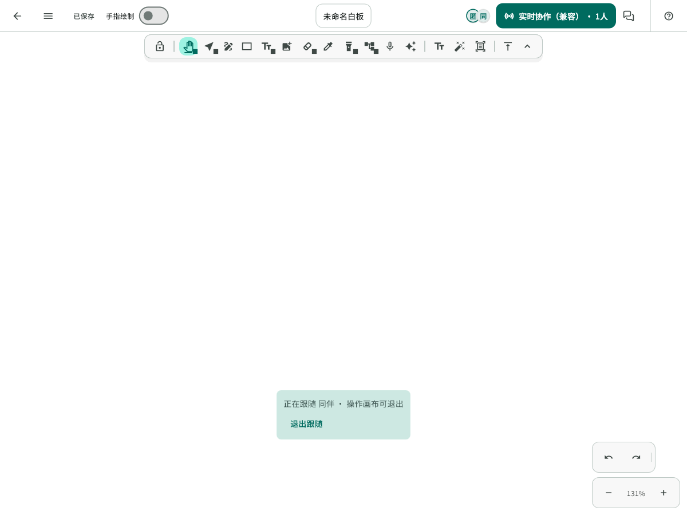
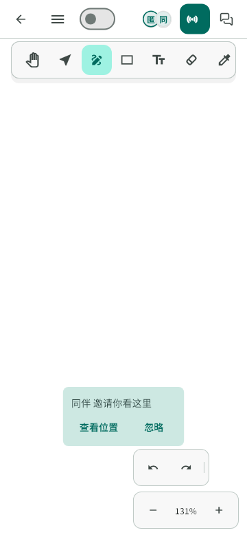

# F2 第一轮：笔身双击切换书写笔与橡皮

## Context

用户要求先实现笔身双击，并同时支持鸿蒙与用于测试的一加 Pad Pro。基于已部署的 `ed3e36d`，在 `feature/f2-stylus-eraser` 开发；前序状态文案提交尚未合入 main，本轮保留它。

## 范围与支持边界

- 双击指笔身感应区域的硬件手势，不识别笔尖双击屏幕。
- 鸿蒙使用 Pen Kit `stylusInteraction.on/off('doubleTap', receiver)`，该接口从 5.1.1 / API 19 起提供。保留最低系统兼容，能力不可用时静默保留工具栏。
- 一加 / OPPO 使用官方 `com.oplus.ipemanager.action.PENCIL_DOUBLE_CLICK` 广播与 `com.oplus.ipemanager.permission.receiver.DOUBLE_CLICK` 权限；仅在系统 `ipe_pencil_double_click = 1`（当前工具与橡皮切换）时处理。其他系统偏好不覆盖。
- 官方说明部分带按键笔会将单击按键映射为同一广播；应用遵循系统上报的动作，不自行把屏幕双击、普通按键或其他广播猜作笔身双击。
- Android 没有可直接等同于所有厂商笔身双击的统一事件，本轮覆盖上述官方广播设备；其他厂商专用接口需按实际设备另接，不声明全面兼容。
- 本轮不包含轻捏菜单、预测报点、振动 SDK、权限角色或后端改动。

## 实现方案

1. 复用编辑器 `switchTool`、`selectBrush` 和已有独立笔状态，在自由书写与橡皮间切换；选择、文字、抓手等工具不响应。
2. 原生通过一个 MethodChannel 上报带订阅代次和时间戳的双击事件。Dart 端共享广播订阅，验证字段、隔离旧代次并去重；缺失插件或系统能力不阻塞页面。
3. 编辑器只在前台、当前路由且画布获得键盘焦点时执行；文本编辑、只读状态和弹出页面不切工具。
4. 落笔期间收到双击时延至本笔正常提交后执行，避免取消半笔；取消、手动切工具、切后台或退出时清掉待执行动作。
5. 鸿蒙、Android 的监听均随前后台与订阅生命周期注册/注销；注销使用原回调对象。一次事件只产生一次操作。
6. 切工具只改变本机编辑状态，不新增 Scene / History / 数据库 / 网络字段；实际擦除仍走已有编辑与可靠同步。

## 关键文件

- `editor_core/src/ui/markdraw_controller.dart`：共享工具切换与落笔保护。
- `editor_core/src/ui/markdraw_editor.dart`、`stylus_double_tap_channel.dart`：订阅、路由/焦点/前后台保护。
- Android `MainActivity.kt`、`StylusDoubleTapChannel.kt`、manifest：官方广播适配。
- 鸿蒙 `EntryAbility.ets`、`StylusDoubleTapChannel.ets`：Pen Kit 与生命周期。
- `test/features/whiteboard/editor_core/`：控制器、通道与页面回归。

## 验证

- 笔型、颜色、粗细与压力状态保留；来回切换不更改 Scene / Undo。
- 长笔期间事件不截断笔迹，终笔完整可撤销；取消或退出不残留待切换动作。
- 重复/非法/旧代次事件、失焦、后台、弹窗和只读均不误触发。
- 静态检查、相关测试、全量 Flutter 回归与 Android 编译。
- 鸿蒙编译取决于本机完整 SDK；未编译或未连接真机必须如实记录。
- 一加与鸿蒙实际笔身双击、后台重进、系统禁用手势和连续协作需真机验收；构建和模拟事件不替代硬件结论。

## 官方依据

- [华为：接入手写交互](https://developer.huawei.com/consumer/cn/doc/harmonyos-guides/pen-stylus-interaction)
- [华为：stylusInteraction](https://developer.huawei.com/consumer/cn/doc/doccenter-references/api/pen-stylusinteraction)
- [OPPO：手写笔 SDK 接口说明，文档 13307](https://open.oppomobile.com/documentation/page/info?id=13307)
- [OPPO：手写笔能力接入指南，文档 13306](https://open.oppomobile.com/documentation/page/info?id=13306)

只接收双击广播，不调用需要授权码的 `PencilManager` 振动/预测等能力；若真机固件还要求厂商授权，记录实际失败并按官方流程处理，不绕过权限。

## 2026-10-24 实施与验证

- 已完成共享工具切换、全局订阅代次/300ms 去重、当前路由/画布焦点/前后台保护，以及鸿蒙 Pen Kit、一加/OPPO 官方广播接入。鸿蒙每次注册使用独立回调代次，注销仍传入原回调，旧的已排队回调不会在恢复前台后执行。
- `flutter analyze --no-pub`：无问题。
- 全量 `flutter test --no-pub --reporter expanded`：1946 通过、5 项既有跳过，未改测试阈值。之后新增“笔尖连续点画两次不算笔身双击”反例，专项文件再跑 12 项全部通过；真实白板页面覆盖工具切换、弹窗、后台恢复及离页。
- 终笔用例分别覆盖湿墨分层开启/关闭，切换不截断笔迹、不产生笔迹取消消息，终笔可撤销；五种笔型的颜色、粗细与压感保持不变。
- Android 在线构建停在 Gradle 依赖元数据网络连接阶段，停止本次构建后用本机缓存执行 `gradlew --offline ... assembleDebug`，81 秒成功、641 个任务。未更改依赖、仓库源、系统代理或原生 SDK 版本。debug APK 位于 `FlowMuse-App/build/app/outputs/apk/debug/app-debug.apk`，仅证明原生编译与打包，不作为书写/协作性能结论。
- 本机配置的 `build/ci-hos-sdk` 为既有空目录占位，不具备完整鸿蒙 SDK；未声称 HAP 已编译。ArkTS 代码按本地官方开发指南与官方 API 19+ 接口实现，仍需真实 SDK 编译与设备验收。
- ADB 未检测到连接设备。一加 Pad Pro 的实际笔型、系统双击设置、广播权限授予及鸿蒙真实手势均未验收。其他 Android 厂商接口未接入。
- 本轮尚未推送、合并或发布；轻捏菜单、预测和振动 SDK 均未实施。

## 发布前的窄画布回归修正

发布界面预览发现，顶部协作控件沿用外层 `MediaQuery` 宽度，在画布实际只有 360px 时仍显示完整兼容模式标签，出现 34px 溢出。编辑器现在将本轮 `LayoutBuilder` 约束直接传给顶部控件，避免窗口尺寸变化时沿用上一帧布局或外层窗口宽度。

小于 480px 且正在显示协作成员头像时，手指绘制开关保留操作、语义名称与悬停说明，省略行内文字以免被头像遮挡；本地笔记窄屏与宽屏继续保留行内文字。增加了紧凑协作入口与开关/头像不重叠的回归断言，既有手指绘制开关测试仍通过。

五项相关页面与真实字体预览通过。以下为内存加密链路的软件夹具画面，硬件双击仍需用户实际操作验收：

发布修正后的最终检查：`flutter analyze --no-pub` 无问题；全量 Flutter 回归 1947 通过、5 项既有跳过。Android arm64 release 离线构建及 Web release 构建成功，未修改测试阈值。

