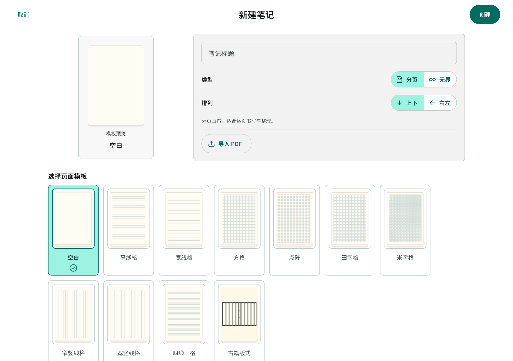
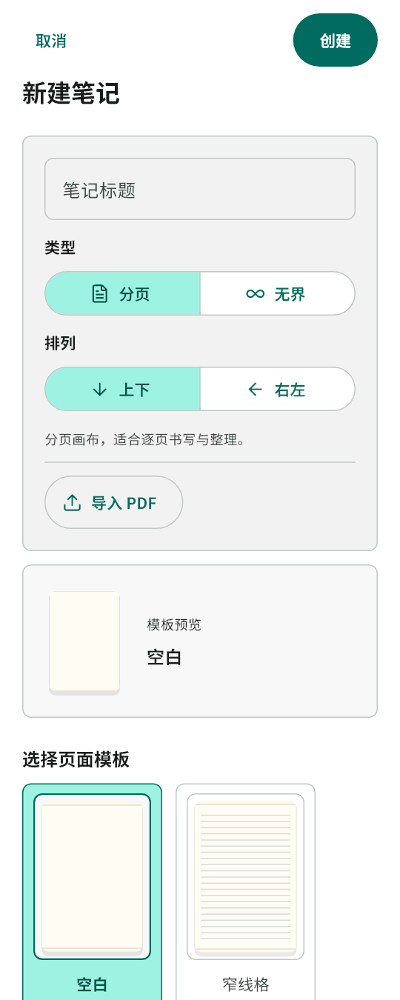
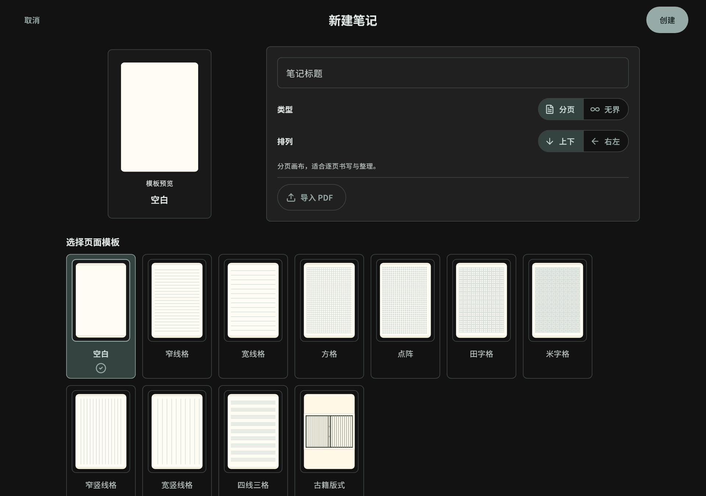
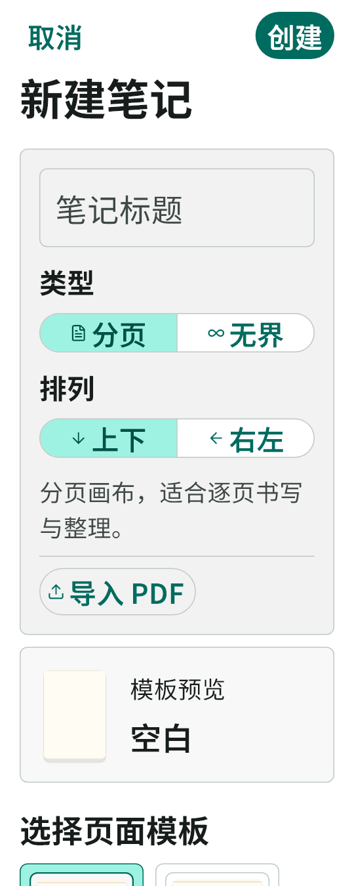
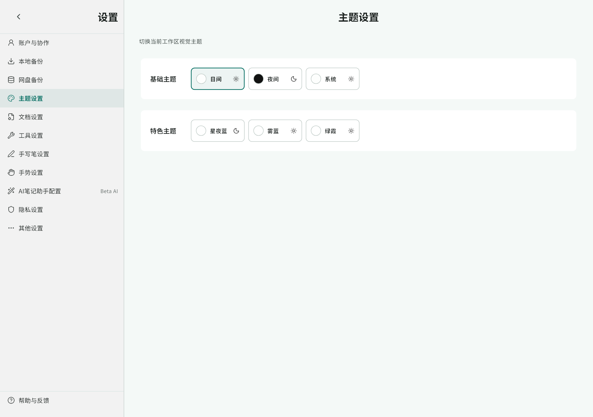
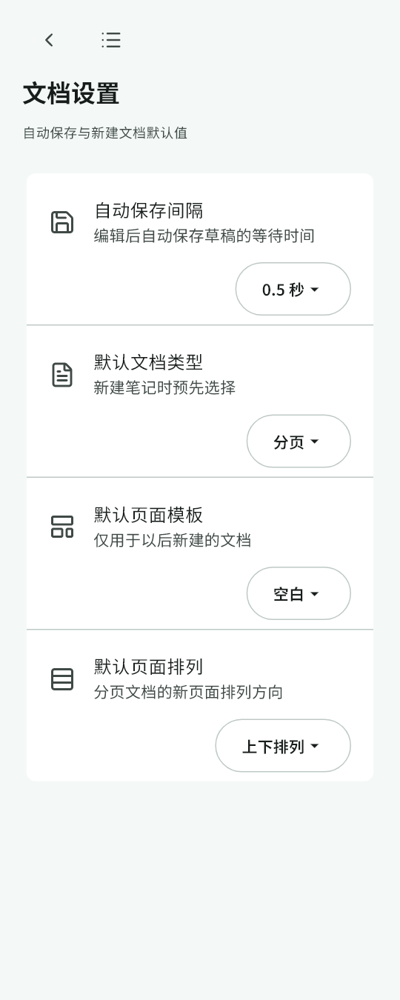
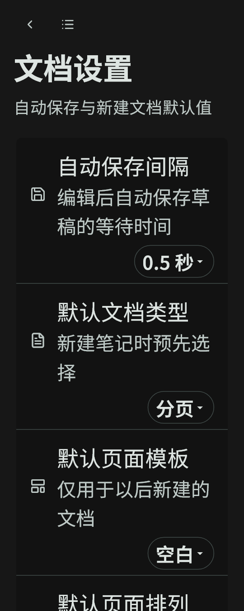
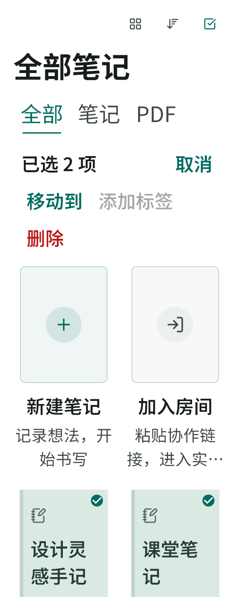

# 第二轮界面优化：新建、批量操作与设置导航

## Context

第一轮已统一纸面风格、字体和动画，并按用户要求恢复笔记名旁的下拉菜单。本轮从 `main/41ad717` 开始，处理新建笔记面板最小宽度、批量工具栏单行布局及设置页固定侧栏造成的窄屏问题。

## 范围与方案

- 新建笔记：复用响应式页头，桌面并排、窄屏纵排；标题输入适应字号，明确 PDF 导入和处理中反馈；模板完整排列，选中样式与轻量过渡遵循减少动画设置。
- 批量操作：数量和取消保持清晰，窄屏操作自动换行，破坏性操作使用错误色；保留原菜单、确认与回调。
- 设置：宽屏保留侧栏，窄屏使用现有锚点菜单切换分类，移除重复边距和标题。文档、工具与压感的下拉选项在窄屏/大字号下置于说明下方，触控范围至少 48px；主题分组与选项支持文字缩放。不动画销毁表单，不改设置保存逻辑。

复用 AppTheme、AppSpacing、AppMotion、RightPageHeader 与锚点菜单。不移动单笔记菜单，不改书写、协作、数据库、原生平台或依赖。

## 验证与交付

先跑相关既有测试，再覆盖 360px、200% 字号、深浅主题、键盘/菜单与减少动画。运行全量 Flutter 测试、静态检查及 release Web 构建，使用生产页面检查桌面和窄屏截图。按新建流程、批量与设置分批提交，附实际验证记录。安卓真机更新继续暂缓。

## 验证结果

- 既有相关基线 29 项通过；新增 10 项回归，覆盖模板、输入、处理中禁用与失败恢复、批量操作、设置分类及值变更、Escape 关闭、窄屏和 200% 字号。
- 完整 Flutter 测试 1920 项通过、5 项既有跳过；`flutter analyze --no-pub` 无问题。
- 加载真实 UI 字体和生产页面，生成并复核 8 张日间/夜间、桌面/窄屏及大字号预览。截图发现的大字号选项挤压和重复标题已修正，随后重新完成全量检查。
- 未修改笔记卡片菜单位置、协作链路或墨迹渲染。尚未进行安卓/鸿蒙真机校准或 GPU 帧耗时测量。

