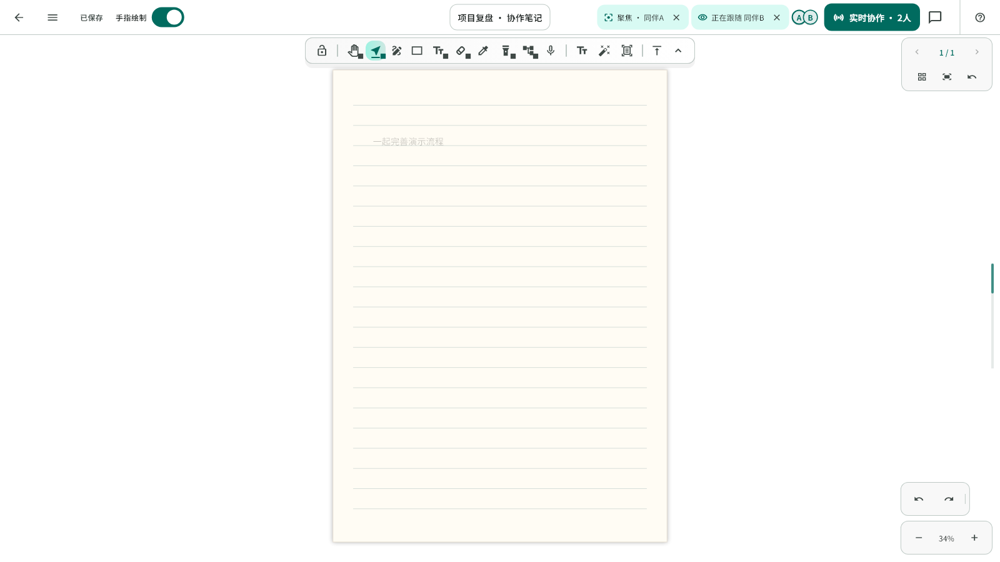
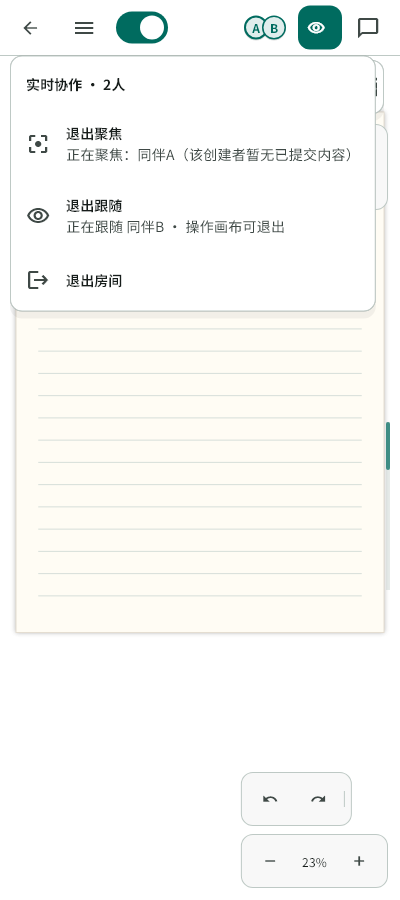

# 协作聚焦与跟随提示的位置优化

## 用户反馈与目标

实测发现：聚焦时的长说明挤动整个头像组；跟随视角的提示独立浮在画布中下方，与顶部协作入口脱节。

将两个持续状态收敛为顶部协作区的轻量状态控件，放在头像之前，保持头像和房间入口的位置稳定。保留目标名称、空内容说明及明确退出操作；窄屏将状态合并进现有协作入口的图标、语义及菜单，保留分别退出的动作。标题按顶部实际剩余空间布局，避免状态出现后覆盖标题。

## 实现范围

- 复用现有颜色、HoverTooltip、StudioRailIconButton 和顶部导航，聚焦与跟随共用一种状态控件；行内只显示名称，空内容和历史会话等说明通过悬停与菜单展示。长名称单行省略，保留完整无障碍语义。
- 将跟随状态从底部浮层移到顶部；主动位置邀请继续沿用已有确认/忽略流程。
- 紧凑布局限制行内可见头像数，多余成员沿用现有 +N 完整列表，状态切换不改变头像组的布局规则。
- 仅调整界面布局和宿主状态传参，不修改跟随/聚焦逻辑、Scene、History、协作消息、网络时序、数据库或原生接口。

## 验证

- 聚焦、跟随、两者同时开启/退出前后，头像与房间入口坐标保持一致。
- 桌面、窄画布、长名称与放大字号下无溢出，控件之间不重叠；完整说明及退出入口可访问。
- 实际页面流程验证跟随持续更新、主动操作退出、离线解除，以及聚焦/跟随分别退出互不影响。
- 生成合成协作数据的真实字体界面预览，检查顶部与画布观感；相关测试、完整 Flutter 回归和静态分析通过后提交。
- 本轮不发布、不更新平板；真实多端触控与设备字号仍需实机复测。

## 实现与检查结果

- 分支：`fix/collaboration-status-header`，基于主线 `45f93cd`。改动仅涉及编辑器顶部布局、状态显示、宿主传参、测试和本记录。
- 原版回归已复现：1280px 下打开长聚焦说明后，头像从 x=1037.6 移到 x=638.1；360px 下同一回归也失败。修复后头像和房间入口的矩形坐标保持一致。
- 顶栏采用现有 Flutter `NavigationToolbar` 约束标题的剩余空间；短状态控件位于头像之前，不再将成员组推向左侧。桌面保留关闭按钮，专注/查看模式也有退出入口。
- 窄屏状态不增加顶栏占位；现有协作按钮显示当前视角状态图标，菜单提供完整说明及“退出聚焦”“退出跟随”。紧凑布局显示前 2 位成员，其余沿用 +N 完整列表。
- 新增 13 项回归：覆盖 360/400/1280/1920px、1/2 倍字号、实际画布小于外层窗口、长名称、双状态、触摸/笔退出、专注模式、菜单独立退出与无障碍名称。实际加密页面工作流增加顶栏位置及无底部跟随浮层断言，并继续覆盖跟随移动、主动操作退出、离线清理和位置邀请确认。
- 相关 4 个测试文件 21 项通过；真实字体预览 2 项通过；完整 Flutter 回归 1977 项通过、5 项原有跳过；`flutter analyze --no-pub` 无问题。收尾的无障碍检查将完整状态合入紧凑按钮的图标语义，避免桌面标签重复朗读。
- 收尾补充桌面短标签的完整语义说明后，13 项顶栏用例再次通过；桌面与窄屏均保留空内容说明的可访问性。
- 预览数据为合成名称与本地测试画布，不包含实际账号、笔记或房间链接。日志和预览生成脚本保存在忽略的 `FlowMuse-App/build/collaboration-status*` 中。
- 上述实现先在本地提交，随后按用户要求推送并部署正式 Web，见下方发布记录；平板保持不更新，真实设备的触控体验仍需复测。

## 正式 Web 发布（2026-10-25）

- 已推送 `fix/collaboration-status-header`。本次从修复分支发布，应用源码为 `b500c6067a4f096c36029c8a17c5991489da299a`；未合并至 `main`，未创建新 PR。
- 正式入口 https://app.flowmuse.cloud/library ，版本 `b500c60`，北京时间 13:08 完成切换；湿墨分层、实时墨迹 V2 保持开启。
- Web release 构建通过；主脚本 SHA-256：`557d1a720cda7fa5f4300443a9ae8fc2c0a8fe3815f074565ed9ee90c26c4ff6`。已检查编译结果包含聚焦、跟随及协作入口的新控件标识。
- 压缩包 SHA-256：`7ceb4c2e3282a73f05eb77ceee55011577d5d59cbcf86d684a3a2163ef568da9`；Nginx 根目录为 `/var/www/flowmuse-app-releases/collab-status-20261025-b500c60`，语法检查和 reload 成功。旧目录 `issue65-reset-20261024-7572010` 及 `/etc/nginx/sites-available/flowmuse-app.before-collab-status-20261025-b500c60` 已保留供回滚。
- 公网 8 项资源状态与哈希核验通过，缓存策略为 `no-cache`；独立 Chrome 环境的桌面及 360px 视图菜单、新建入口、加入房间弹窗检查通过，页面异常为 0。此检查没有创建真实协作房间，不替代双端体验验收。
- 后端容器身份和镜像 `flowmuse-collab:room-management-4e92510` 在发布前后保持一致，公网健康检查为 `{"status":"ok"}`。按用户要求，本轮没有更新平板。
- 服务器回执：`/opt/flowmuse/releases/collab-status-20261025-b500c60/web-deployment.json`；本地压缩包、资源校验和浏览器检查记录保留在忽略的 `FlowMuse-App/build/collaboration-status-release/`。

## 界面预览

顶部局部（聚焦与跟随同时开启）：

桌面完整画面，跟随不再占用画布中下方：

窄屏协作菜单保留状态详情和分别退出：

