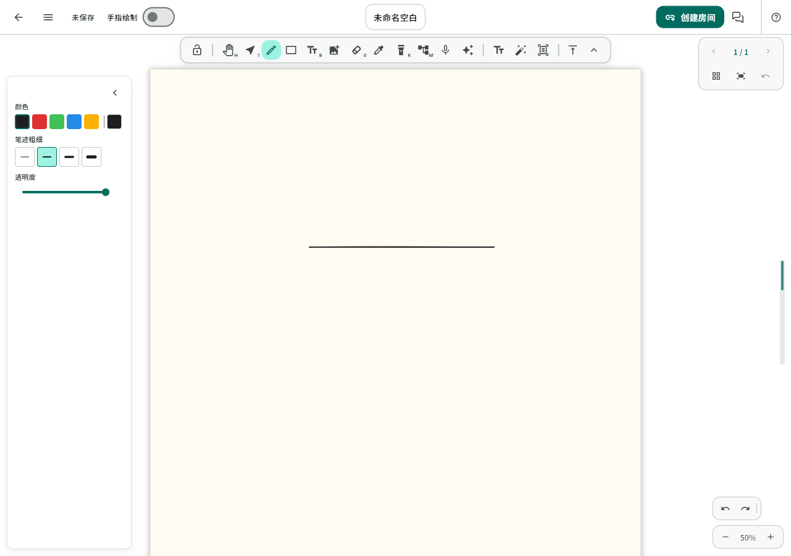
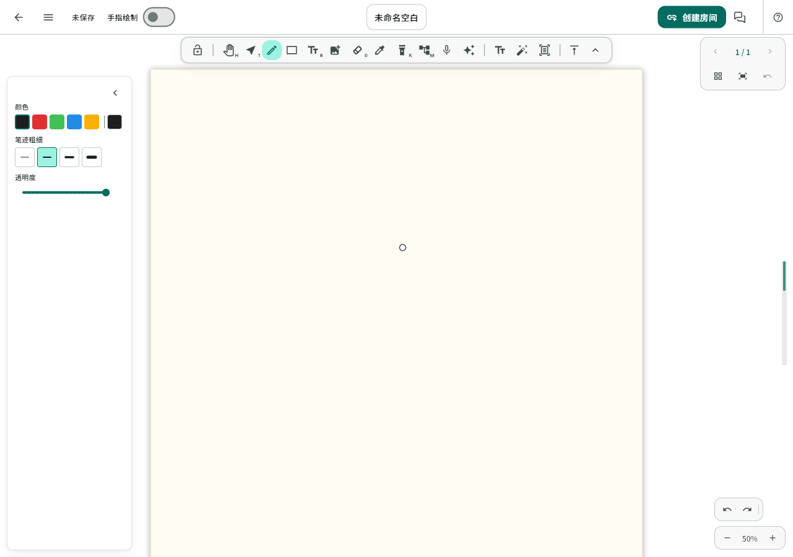

# Issue #84：橡皮光标与笔尖重压临时擦除

## 背景与范围

基于 main `efa1637`，分支 `feature/issue84-stylus-pressure-eraser`。PR #85 的取色修复独立保留；后续部署时须确认已带上该已上线修复，避免退回旧取色实现。本轮先实现和验证，不发布或更新平板。

## 行为约定

- Web 与桌面保留画布内悬停光标，离开画布隐藏。Android/iOS/鸿蒙原生 App 仅在手写笔接触时显示橡皮圆形光标；落笔立即定位，抬笔/取消/中断时隐藏，不以窗口宽度判断平台。
- 自由书写的落笔起始，归一化原始笔尖压感达到 0.8、持续 550 ms、位移不超过 4 个逻辑像素后，本次接触变成临时橡皮。超过起笔位移范围后，本笔不再识别重压停留，不在书写中途顿笔时触发。
- 仅正常 stylus 笔尖参与，排除鼠标、触摸、倒置笔、不合法压感及从头到尾恒定满压的输入；范围缺省时复用已有 0..1 压感回退，不使用笔粗灵敏度或平滑后的压感。阈值是保守初值，仍需一加/鸿蒙真机校准。
- 工具栏与笔型/颜色/粗细/压感设置保持原值，抬笔回到自由书写；临时橡皮复用现有整元素/整组擦除、锁定与级联清理语义，不新增局部擦除。
- 触发时取消本地待提交笔迹及远端活动预览，正常删除仍走已有协作链路；一次擦除对应一条可撤销操作，不残留墨点或预览，不回滚协作者的新内容。
- 取消、切工具、双指视口手势、换笔记、后台、弹窗及释放均收尾。重压擦除与笔身双击独立；临时擦除期间不积累抬笔后的隐式工具切换。

## 实施步骤

1. 修复原生移动端光标可见性、落笔定位和离开画布清理；先补回归。
2. 修复擦除取消后删除结果没有撤销记录的缺陷，覆盖正常/取消、锁定、分组和协作撤销；单独提交。
3. 接入起笔重压计时与独立临时 EraserTool；复用现有活动笔迹取消、场景更新和历史，补齐生命周期及工具切换防护。
4. 文档、相关及全量 Flutter 回归、静态分析、Web release 与合成输入/截图检查；不增加后端、协议、数据库或原生手写笔 SDK 依赖。

## 验证边界

- 合成输入覆盖平台/宽度差异，悬停/接触/抬笔/取消/移出，手指与外接鼠标不出现不可见的系统指针。
- 重压、低压、短压、持续压感、微抖、位移取消、普通顿笔、非所有者指针、恒定满压、非法压感、缩放、各笔型和手动切工具。
- 触发前的本地/远端预览取消，一次擦除一次撤销/重做，远端新元素保留，后台/弹窗/换页/销毁无迟到触发；笔身双击不回退。
- 不将软件事件回放当成真实手写笔验收；未连接实机时明确记录阈值和舒适度待验。

## 第一阶段回执

- 光标策略收敛到现有 InputPolicySelector，区分 Web/桌面与原生移动端，不读取窗口宽度。原生移动端外接鼠标保留系统指针；跟踪擦除指针所有权，其他指针抬起/取消不能结束当前擦除。
- 擦除取消、切工具及视口手势中断在清除操作基线前保存历史；撤销/重做仍保留远端新增元素，不更改协作合并算法。
- 新增 11 项交互回归，相关 30 项通过；完整 Flutter 回归 1988 项通过、5 项既有跳过，静态分析无问题。当前分支基于 main，不含 PR #85 的 13 项取色新增测试，不能直接与该分支测试总数比较。
- 本阶段没有 Web 发布、平板安装或鸿蒙真机验证。

## 第二阶段回执

- 起笔手势仅创建一个 550 ms 单次计时器，达到归一化压感 0.8 且位移不超过 4 个逻辑像素时触发。压力下降重新计时，移动超限后本笔不再识别；从头到尾恒定默认满压、非正常笔尖、非有限值及不合法范围不触发。范围缺省时沿用现有归一化 helper 的 0..1 回退。
- 临时 EraserTool 与工具栏选中工具分离，原笔型与样式不变。先经已有取消通路清除未提交笔迹、本地湿墨和远端预览，再执行正常删除；抬笔收尾后原 FreedrawTool 可以继续书写。没有更改笔迹格式、绘制算法、协作协议或后台服务。
- 取消、手动切工具、视口手势、布局/尺寸变化、换笔记、Undo/Redo、后台、失焦、弹窗及销毁都会取消待触发手势并收尾已发生擦除。笔身双击取消待识别手势，临时擦除期间不积累抬笔后的工具切换。
- 只在本地实际替换文档时清理活动输入；远端全场景更新继续保留本地输入和临时擦除，不能把关闭临时 UI 误用为中断协作笔迹。
- 新增 48 项控制器回归，覆盖五种笔形、湿墨分层/V1/V2 组合、缺省/自定义压力范围、非法/恒定满压、微抖/移动/短压、多指针、分组/锁定、生命周期及远端全场景更新。与既有橡皮、笔身双击和协作撤销回归合计 77 项通过。
- 新增真实 WhiteboardPage + EditorCanvas + 内存加密房间工作流：笔尖事件触发擦除，远端收到删除；撤销与重做继续广播，并保留远端新元素。该流程通过。
- 完整 Flutter 回归 2037 项通过，5 项既有跳过；`flutter analyze --no-pub` 无问题，`git diff --check` 通过。没有修改后端或原生 Platform Channel，不需要新增 SDK/依赖。
- 正式配置的 Web release 构建成功（本地验证用，未部署），湿墨分层和实时墨迹 V2 开启，主脚本 SHA-256：`d6027a22f5b4638f0a4adb4d4a1f00f9b6977b0a96df94b4b04af8d03c8163fe`。

### 浏览器界面验证

独立临时 Chrome、本地静态服务器和合成画布，使用 CDP 笔尖事件（压力 0.9、停留 700 ms），没有读取真实笔记/账号或创建生产协作房间。确认擦除、抬笔恢复、Undo、Web 悬停和移出行为；取样区域原墨迹暗像素为 122，擦除后为 0，撤销后恢复为 122。触发前与临时擦除期间的工具栏像素完全一致，页面新增异常为 0。

浏览器沿用现有笔型菜单；该菜单的禁用外层没有发布子按钮语义，本地脚本在检查合成截图后点击固定视口中的钢笔按钮。本轮没有处理该既有可访问性问题。事件回放、日志与像素核验脚本位于忽略目录 `FlowMuse-App/build/issue84/`，仅以下合成截图入库。

触发前：

临时擦除期间，工具栏仍选择钢笔：

### 未验证范围

没有连接真实手写笔测试，也没有安装或部署本轮版本。默认阈值、微抖容差与持续时间仍需一加 Pad Pro 和鸿蒙设备校准；软件事件回放不能证明所有厂商设备的触发舒适度。后续发布前需要合入已上线的 PR #85 取色修复，避免客户端功能回退。
