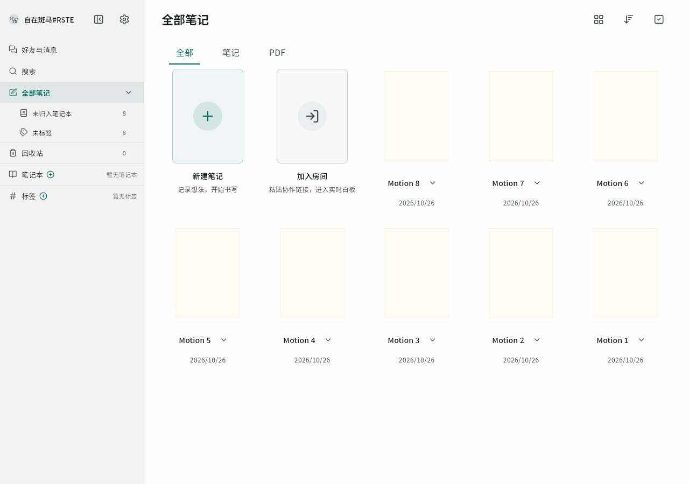
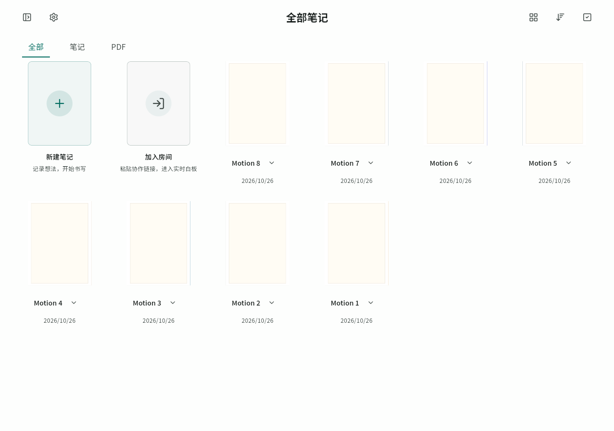
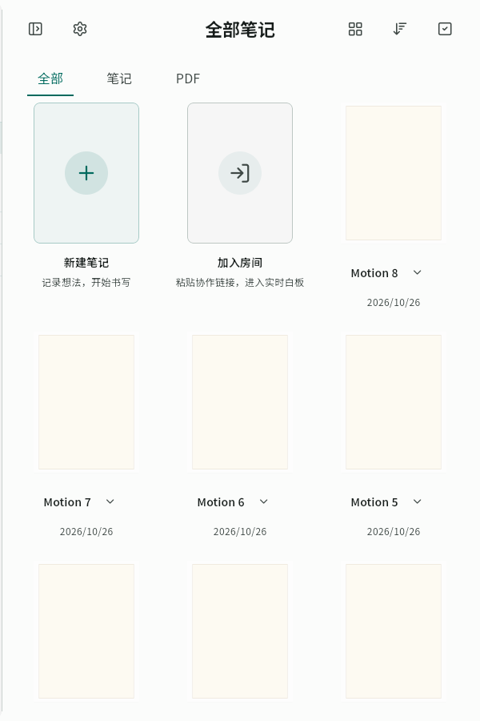

# 资料库侧栏与笔记网格动效

## Context

用户反馈主页侧栏开合稍有卡顿，笔记位置调整生硬。从已合并 #90 的主线 `0fc05b3d` 新建 `fix/library-sidebar-motion`，初始阶段仅本地优化。后续用户要求推送、部署 Web 并提交 PR，发布记录见末尾。

## 勘察与范围

- AppShell 用宽度动画推动内容区，侧栏依赖裁切/淡出；首页顶层 LayoutBuilder 每帧创建新的 LibraryContent，连带更新列表、筛选及封面组件。
- 首页及笔记本/标签详情网格使用最大列宽代理，列数是离散值；侧栏宽度变化触发整行换位，只有侧栏在动画，笔记位置没有过渡。
- 复用 AppMotion 的节奏、减少动画设置、既有 GridView 的按需构建及 NoteCard，不引入动画依赖，不改笔记数据、排序、选择和菜单。

## 实施

1. 首页缓存当次 build 的宽/窄两种 LibraryContent 实例，约束变化只选择实例，避免每帧重建整页；数据变化仍正常更新。
2. 侧栏用一个开合进度统一宽度、平移及透明度，隔离侧栏重绘，保留抽屉与响应式断点。
3. 共用笔记网格在列数/间距变化时插值布局，保留虚拟化、滚动、点击和文字缩放；动画 tick 复用 child delegate，避免重复创建封面组件。
4. 同时验证连续反向切换、减少动画、窄屏抽屉和大量笔记。回归测试记录中间位置与组件构建次数，Web release 中核对实际动画和帧间隔，不把组件测试耗时当作设备帧率。

## 验证

先复现构建次数及换列跳变；运行相关组件测试、analyze、全量测试和 Web release，使用匿名合成笔记验证。原生实机性能、发布和 PR 不在本轮已完成范围。

## 实施结果

- 1280×900、24 条合成笔记、每 16ms 推进侧栏动画的相同组件回归：基线首页内容重建 **13 次**，修复后 **0 次**；笔记垂直位移峰值从 **292px/帧** 降为 **65.6px/帧**，经过中间位置。该数字用于验证连续性，不代表设备帧率。
- 侧栏只保留一个动画进度，并隔离其重绘；隐藏时移除键盘聚焦和辅助功能入口，原有抽屉入口保留。
- NoteGrid 复用现有卡片和虚拟列表，布局代理插值位置/尺寸，不给每张卡片建立动画控制器；二分查找可见索引，避免深滚动时构建两套布局的索引并集。
- 窗口尺寸变化直接重排；跨过窄屏断点时侧栏也直接切换，避免旧列数挤压成极窄卡片。减少动画时不启动过渡。
- 8 项新增回归覆盖整页重建、位置连续、抽屉、LTR/RTL、减少动画、快速反向切换/销毁、十万项深滚动的按需构建及几何边界。40 项相关测试通过，analyze 无问题，全量 **2075 项通过、5 项既有跳过**。

## 本地验证与边界（发布前）

- 追加系统字号变更回归：过渡沿用旧卡片高度时可复现约 44px 的文字溢出，修复为字号/高度变化直接采用最终布局；列数变化继续动画。
- 最终源码提交 `cc182d4f63206581ede5e73a61cd83e114f367fb`，Web release 构建成功（92.3 秒），沿用根路径、本地 CanvasKit、正式 API/分享入口和两个 true 墨迹开关；本轮不打发布归档。主 JS SHA-256 为 `6bdaaf0adb9ab26505dc838fff14824e3b2e1dc308837ad994edea6a1b46feeb`。
- Windows Chrome、1280×900、8 条本地匿名合成笔记，真实点击侧栏按钮采样卡片位置：线上基线只有 **2 个 Y 位置状态、单次跳动 292px**；最终修复版有 **10 个中间位置状态、最大单次位移约 95.8px**，未捕获页面错误。
- 同一浏览器验证卡片菜单能在换列后正确打开，菜单仍在笔记名旁；重新打开侧栏并缩到 600px 后，抽屉打开/关闭及列表布局正常。截图已人工检查，均为合成资料库。
- 浏览器使用 headless/软件渲染并启用辅助功能树观察位置；基线采样时还存在并行测试负载。rAF 原始间隔保留在本地日志，但**不能据此推断实机 FPS 或计算性能提升比例**。连续性另由相同时间步长的组件回归确认。
- 首轮全量 2075 项通过。补充字号测试后，一轮与浏览器并行的全量运行中，原有画笔静态性能门禁为 3.03、超出既有 3.0 阈值；单独复测为 2.94，最终完整运行中为 2.49，均未更改门槛或画笔实现。
- 另一次复测暴露原有 presence 测试联网下载 Nunito 失败；其断言只涉及编辑状态，现改为使用包内 Excalifont，使该测试独立于外网，不改变产品字体策略。
- 最终 analyze 无问题；**2076 项全量测试通过、5 项既有跳过**。9 项新增测试和字体隔离修复均已覆盖。源码本地分次提交，工作区干净；未推送、部署或创建 PR，未测安卓/鸿蒙实机帧率。

## 正式 Web 发布

- `fix/library-sidebar-motion` 已推送；发布前重新 fetch，主线仍为 `0fc05b3d`，应用源码与通过验证的 `cc182d4f63206581ede5e73a61cd83e114f367fb` 一致，复用该次构建产物。
- **2026-10-26 20:38（北京时间）** 上线 [正式 Web](https://app.flowmuse.cloud/library)，发布 ID `library-sidebar-20261026-cc182d4`。主脚本哈希与本地验证记录相同；Nginx 检查及 reload 成功，后端容器 ID/镜像未变，健康检查通过。
- 公网版本信息、入口、主脚本、扫码解码脚本、三套 UI 字体、字体许可证及 Chromium CanvasKit JS/Wasm 共 **10 项资源返回 200、哈希一致**，缓存头均为 `no-cache`。
- 线上 Chrome 使用 8 条匿名合成笔记复测侧栏开合、换列后菜单定位和 600px 抽屉开合，均通过；位置采样包含 **11 个 Y 状态**，最大单次位移约 81.1px，无未捕获页面错误。此采样仍只验证连续性，不代表实机 FPS。
- 本地及服务器临时上传归档、服务器临时部署脚本已清除；保留编译输出、脱敏验证收据和必要的回退目录，不累积整包备份。
- 本次发布记录单独提交；PR 中应用源码与已部署版本相同，目标为 main，创建后停止，不等待 CI/审查，不自动合并。安卓/鸿蒙实机帧率仍未验证。
