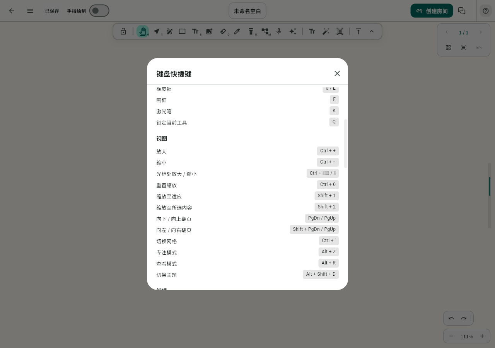

# Web 笔记 Ctrl＋滚轮缩放

## Context

用户要求先清理冗余分支，再完善 Web 笔记的 Ctrl＋滚轮缩放。工作区干净，从当前主线 `9d7f93a5` 创建独立分支 `fix/web-ctrl-wheel-zoom`；尚未合并的 PR #89（`chore/project-cleanup`）保持独立。

## 分支清理

以下 5 个分支的本地/远端 tip 均已完整包含在 `origin/main`，对应 PR 已合并，且没有其他 worktree 使用。远端删除使用预期 tip 的 lease 和原子提交，本地使用 `git branch -d`，不强制删除未合入提交：

- `feature/issue84-stylus-pressure-eraser`（#86）
- `fix/collaboration-status-header`（#83）
- `fix/pdf-local-writing-jank`（#88）
- `fix/stylus-eraser-feel`（#87）
- `fix/web-eyedropper-performance`（#85）

保留 `main`、`gh-pages`、PR #89 的分支和本轮工作分支，不新建备份分支。

## 原因与改动范围

本机固定 OHOS Flutter 3.41.10 的 Web 引擎在 `pointer_binding.dart` 中，将 Ctrl＋wheel 转为 `PointerScaleEvent`（`scale = exp(-deltaY / 200)`）。`MarkdrawController.onPointerSignal` 只处理 `PointerScrollEvent`，已有的 Ctrl 判断无法接到这条 Web 事件。

- 复用 `ViewportState.zoomAt`、缩放上下限和现有视口约束，消费缩放事件，围绕指针位置改变笔记缩放。
- 保留普通分页滚轮翻页与已有桌面 Ctrl/Command 滚轮处理；零垂直滚动、单位或非法缩放值不触发缩放。
- 快捷键帮助补充滚轮说明；按实际主题平台显示 Ctrl 或 Cmd，修正 Web 一律显示 Cmd 的说明。
- 不添加全局 DOM 滚轮拦截，不改笔记正文、保存格式、协作协议或原生平台通道。

## 验证

先用缩放事件复现现有失效，再验证放大/缩小、鼠标锚点、最小/最大缩放、分页普通滚轮与修饰键、零/非法事件、Canvas 事件转发及帮助文字。运行相关测试、Flutter analyze、全量测试与 Web release 构建；干净 Chrome 发送真实 Ctrl＋wheel，核对笔记缩放、页面缩放及普通滚动。

本轮用户未要求部署或提交 PR，完成代码与本地验证后记录结果。

## 实施与初步结果

- 基线回归确认缩放信号被忽略：期望倍率 1.25，实际仍为 1.0。
- 控制器补齐 `PointerScaleEvent`，保留分页滚轮和既有 Ctrl/Meta 路径；单位/非法倍率及零垂直滚动返回，不写场景或撤销历史。
- 帮助面板增加滚轮行并按实际平台选择 Ctrl/Cmd。未添加 DOM 全局拦截或新的缩放参数。
- 8 项新增回归覆盖倍率、锚点、边界、非法值、分页/修饰键、Canvas 局部坐标和帮助文字；19 项相关测试通过。
- Flutter analyze 无问题，全量 **2067 项通过、5 项既有跳过**。验证日志在本地忽略目录 `FlowMuse-App/build/web-ctrl-wheel/`。

## 最终浏览器与构建验证

- 源码提交 `41a2a179`，Web release 构建成功（94.1 秒）。使用独立验证输出目录 `FlowMuse-App/build/web-ctrl-wheel/web`，没有打发布归档或覆盖线上站点；墨迹两项 define 显式为 true，与线上模式一致。
- 标准 JavaScript/CanvasKit 产物验证通过；构建仍提示部分现有依赖不支持 Wasm 和缺少 Cupertino 字体，本轮未改构建目标、字体或依赖。
- Windows Chrome、1280×900、匿名新建本地笔记，真实按住 Ctrl 后分别发送 `wheel(0, -60)`、`wheel(0, 60)`：

| 版本 | 初始 | 向上滚动 | 向下滚动 |
| --- | --- | --- | --- |
| 当前线上基线 | 50% | 50% | 50% |
| 本地修复版 | 50% | 67% | 50% |

- 修复版另放大至 111%，松开 Ctrl 后普通滚轮仍保持 111%；浏览器 DPR、`visualViewport.scale`、窗口宽度均未变化，无未捕获页面错误。
- 浏览器帮助面板已能看到 `Ctrl + 滚轮上 / 下`，已人工检查截图。Mac 的 Cmd 路径有组件回归覆盖，未作 Mac 实机验证。
- 发布 JS 的本地 SHA-256：`d5fa18f0004feb4353986328c51d57de55f5b0edb0f5629f997f52b058ac8e3f`。原始收据保留在本地忽略目录，图为一次性合成空白笔记，无账号/房间数据。
- 结束前再次核对远端，仅保留 `main`、`gh-pages`、`chore/project-cleanup`；本轮修复分支仅本地提交，未推送、部署或创建 PR。

