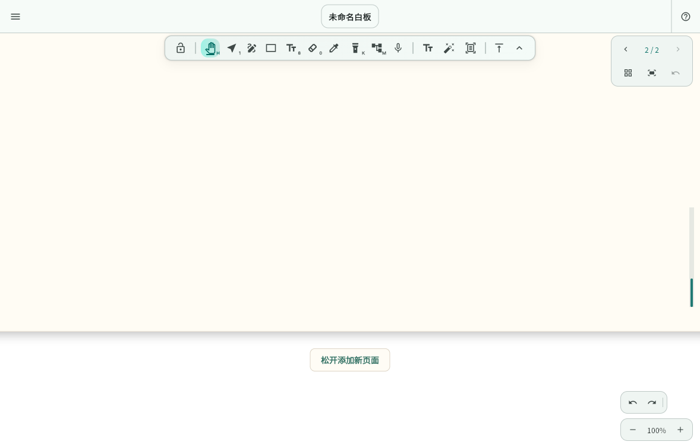
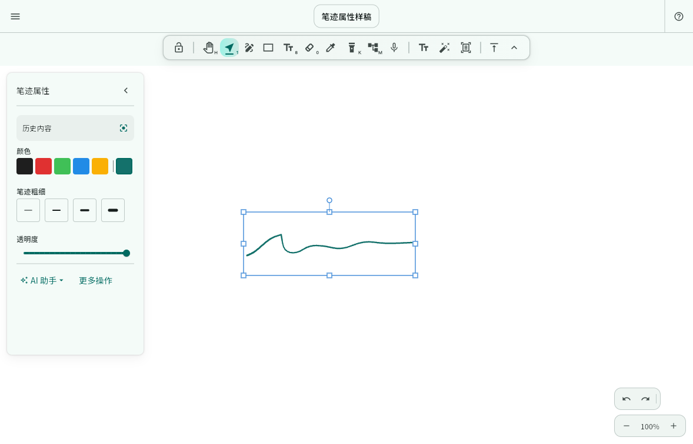

# 分页笔记鼠标触底新增页面修复

## 问题与范围

有限画布的新增页弹性手势目前仅由 `EditorCanvas` 的触屏拖动触发。滚轮走控制器的边界限制，抓手鼠标拖动走 HandTool，均无法进入新增页逻辑。用户确认两个入口都存在问题。

## 实现

- 复用现有弹性位移、阈值提示和 `appendPageAfterLastAndScroll`，将抓手鼠标拖动接入同一处理流程，保留普通抓手的控制器事件。
- 普通滚轮在最后一页边界继续滚动时累计弹性位移，停止滚动后达到阈值才新增一页。反向滚动降低累计值，缩放及新的指针操作取消待执行的滚轮新增。
- 只读、控制器切换、画布布局变化及组件销毁时保护延迟回调；保持 Ctrl/Cmd 滚轮缩放、触屏书写和无限画布入口。
- 新增页沿用既有页面标记、模板、页面方向、保存与协作出口，并保留一次撤销。

## 验证

- 回归先复现滚轮及抓手均无法增页，再覆盖上下排列和右到左排列。
- 检查反向撤回、未到阈值、只读、缩放、切换控制器与撤销重做。
- 运行相关测试、静态检查及完整 Flutter 回归，Web 浏览器冒烟验证真实 wheel 与鼠标拖动。

## 交付状态

实现完成，尚未发布。

- 修复前的滚轮回归稳定复现页数仍为 1、预期为 2 的失败。
- 完整 Flutter 回归 2156 项通过，原有 5 项跳过。`lib` 与 `test` 静态分析无问题。全目录分析另有 `build/license-review` 的旧验证脚本依赖缺失错误及旧构建目录提示，本次未修改这些文件。
- 本地 Chrome 验证页以浏览器输入事件实际触发 wheel 和鼠标抓手拖动，页数依次为 1、2、3，撤销后恢复为 2；反向滚动及只读操作均未误增页，无浏览器异常。验证入口补齐 Flutter 初始化后通过，临时脚本和产物位于忽略的 `build/paged-mouse-append-check/`。
- 物理鼠标和触控板的惯性滚动手感，以及平板实机尚未人工复测。

## 界面验证截图

本地 Chrome 验证页中，抓手越过末页边界、尚未松开鼠标时的新增页提示。

同分支的选区侧栏样稿，使用虚构笔迹展示面板比例与常用操作。

