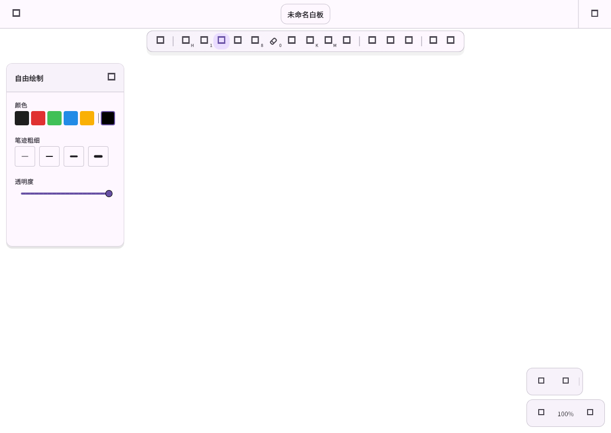
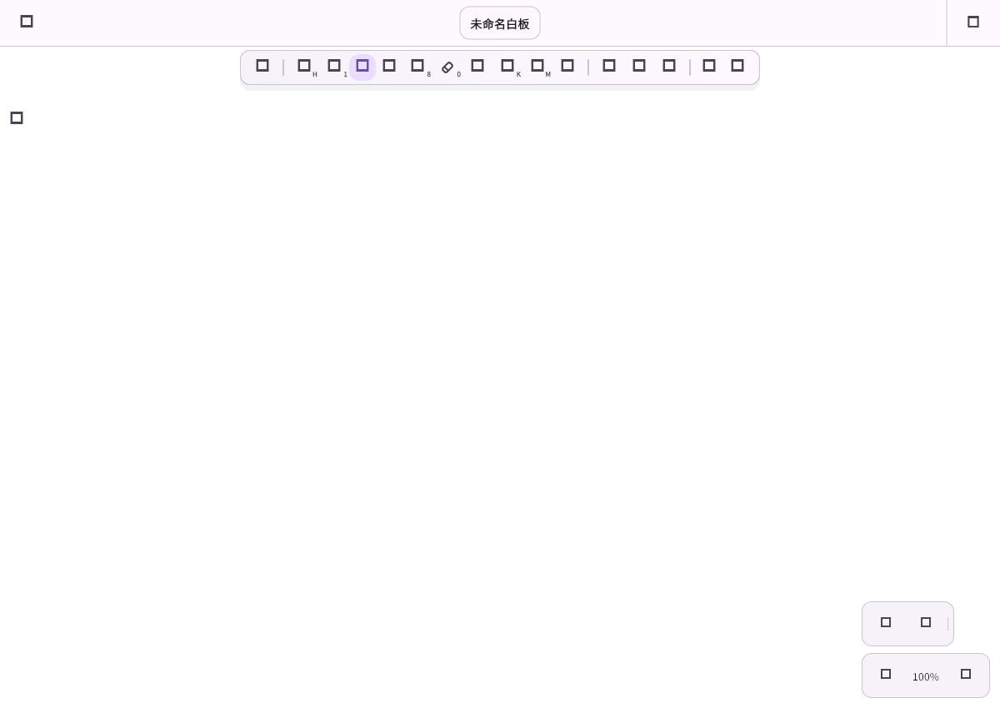

# Issue #111：轻点画布空白收起属性面板

## Context 与需求

工具／选区属性面板目前通过箭头收起。新增轻点画布空白收起，实际落笔、绘制、拖动及双指手势继续执行。范围为编辑器属性面板，不扩展到页面预览或 AI 助手。

## 实现方案与关键文件

- `editor_canvas.dart` 在现有原始指针流程旁记录轻点候选，抬手并完成原操作后才通知；复用场景命中检测，排除移动、长按、取消、多指、场景／视口变化及工具创建预览，不参与手势竞争。
- `markdraw_editor.dart` 复用现有折叠状态和展开入口，切换工具或选区仍恢复面板。
- 同步产品需求，补充鼠标、触屏、触控笔的关键交互回归。
- 不改平台工程、数据库、Scene 格式或协作协议，不引入平台分支或依赖。

## 验证方案与实施步骤

1. 补充交互测试，验证空白轻点收起及重新展开，绘制、拖动、双指与取消不误触发。
2. 执行相关回归、`flutter analyze --no-pub` 和完整 `flutter test --no-pub`。
3. 直接运行到已连接的鸿蒙平板，记录构建／启动结果；真实手感由使用者验收。

## 实施与验证结果

- 分支：`codex/fix-111-canvas-tap-collapse`，基于 `4be40c40` 开发。
- `flutter analyze --no-pub`：无问题；新增交互和直接调用方共 40 项测试通过。
- `flutter test --no-pub`：2226 项通过，5 项跳过，无失败；覆盖保存、撤销、选择和协作完整回归。
- 2026-11-10 22:20（北京时间）执行 `flutter run --profile -d <已连接鸿蒙平板> --no-pub --dart-define=FLOWMUSE_LAYERED_WET_INK=true --dart-define=FLOWMUSE_LIVE_INK_V2=true`，HAP 构建、覆盖安装、应用启动与 VM Service 连接成功，原有资料库正常打开；未卸载应用或清理数据。
- 产物：`FlowMuse-App/build/ohos/hap/entry-default-signed.hap`，SHA-256：`e773ca92228367f744cdeaf2bde4ba2afa4a4db91a22f97c45d127c5b557dea4`。
- 真实触控与手写手感交由使用者测试；Android、iOS、桌面与 Web 未做本次实机验证。共享改动不引入平台 API／分支，数据和协议不变。

## 交互截图

以下为真实编辑器组件的匿名空白画布截图，采用默认布局，不读取用户笔记；不代表平板实机截图。

