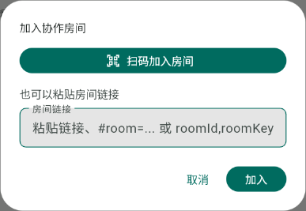

# 协作扫码入房验证记录

日期：2026-10-22。功能提交：`3893ab46b7c65159b0c2cc58bf4d93d8726180c3`。分支：`feature/collaboration-qr-join`。

## 使用入口

| 场景 | 操作 |
| --- | --- |
| 房主展示二维码 | 创建房间后查看分享面板；已在协作中可从协作菜单再次打开“分享房间” |
| 安卓 App / Web 内扫码 | 资料库或白板的“加入房间”→“扫码加入房间”，允许使用相机 |
| 手机系统相机扫码 | 识别同一个 HTTPS 邀请二维码后打开 Web，复用访客协作入口，无需添加好友或安装 App |
| 无摄像头、权限拒绝 | 返回加入弹窗，粘贴原有房间链接或房间码 |

扫码只解析现有房间数据，不执行二维码里的任意外部地址。房间密钥继续保存在链接 fragment；后端、协作消息、保存格式和好友权限不变。

## 软件验证

- 全量 `flutter test --no-pub`：**1855 通过、5 项既有跳过**。
- `flutter analyze --no-pub`：**No issues found**。首次检查发现上一次 #65 的本地截图脚本也被扫描，已将该临时文件保留为 `build/issue65/visual_test.dart.saved`，未改动正式检查规则。
- 新增 14 项组件测试，覆盖二维码数据边界与窄屏、扫码成功/取消/异常/重复触发、迟到结果、多码识别、权限拒绝、无摄像头、后台恢复、系统返回释放相机及嵌套加入弹窗返回。另扩展原有完整页面分享流程和 HTTPS 路由测试。
- 末次间距 token 与文案调整后复跑 14 项组件测试，加本地二维码图片导出检查，共 15 项通过。
- Web release 与 Android ARM64 release 均成功构建。没有修改原生插件注册或鸿蒙源码。

复跑命令（使用项目指定的 OpenHarmony Flutter SDK，设置有效的本地 SDK 与 pub cache 环境）：

```powershell
flutter test --no-pub test/features/whiteboard/collaboration/widgets test/app/app_router_network_links_test.dart test/features/whiteboard/views/whiteboard_writing_workflow_test.dart
flutter test --no-pub
flutter analyze --no-pub
```

## 浏览器检查

对本机构建的 release 站点执行，未修改线上账号、笔记或房间。

1. 用真正的 `RoomInviteQr` 组件导出公开的假房间二维码，再用站点内的 ZXing 0.23.0 在 Chromium 解码；完整 HTTPS 邀请逐字相等，密钥只在 fragment。
2. 用 canvas 视频流模拟摄像头，走实际“加入房间→扫码”页面。相机请求 1 次，成功识别后扫码层关闭、调用原有入房流程，视频轨道停止且状态为 `ended`。测试拦截假房间的请求返回 404，并未进入真实在线协作房间。
3. 解码资源请求指向本站 `scanner/zxing-0.23.0.min.js`，外部 ZXing 请求数为 0。这一结论只覆盖扫码资源，项目原有 PDF/头像等资源不在本轮范围。
4. 新会话模拟浏览器拒绝权限，显示中文指引，返回后保留可用的粘贴入口；该次复跑无控制台错误。

诊断记录：先前连续执行假房间入房失败、权限拒绝和无障碍截图时曾记录一次 Flutter Web 文本输入桥接栈错误；新会话复跑未复现，未据此修改输入引擎。初始视频帧还出现过 ZXing 识别与播放警告，后续能正常识别并释放轨道。上述浏览器检查不能替代物理摄像头验收。

真实 Web 加入弹窗（仅截图弹窗，无账号或房间数据）：



二维码组件预览（非真实房间，使用本地中文字体导出，不是线上房间截图）：


## 构建产物

两端构建参数均保持 `FLOWMUSE_LAYERED_WET_INK=true`、`FLOWMUSE_LIVE_INK_V2=true`、`FLOWMUSE_SHARE_ORIGIN=https://app.flowmuse.cloud`、`FLOWMUSE_BUILD_ID=3893ab4`。

| 产物 | 路径（相对 FlowMuse-App） | SHA-256 |
| --- | --- | --- |
| Web | `build/qr-join/web/main.dart.js` | `718634c2050255b50e1b50e097edda91d5e1ca35c291bcf3d5a42c3b4de15233` |
| Android | `build/qr-join/flowmuse-qr-join-3893ab4-arm64.apk` | `700db89064e70db7c5460db70cfc4a5ac8973a798f455a6b713381f00d35f9a5` |

APK 为 195580807 字节。已验证包名 `com.example.flowmuse`、原有签名、Flutter 引擎与上一包相同，核心引擎与应用为 ARM64；预编译依赖包含的其他 ABI 库也逐一检查 ELF 与目录匹配。相机权限存在，摄像头硬件为可选。Web 解码器与许可证随构建输出，摘要符合第三方登记记录。详细回执在本地 `build/qr-join/artifact-receipt.json`。

## 待人工验收与交付边界

- 尚未发布正式 Web，尚未覆盖安装平板；后端未调整。
- 安卓真机相机对焦、权限首次申请、后台切换与再次打开扫码，需要安装本轮 APK 后验证。
- Web 真机摄像头、手机系统相机识别后打开 Web 并真正加入房主房间，需要在 HTTPS 测试站点或正式部署后验证。
- 鸿蒙内置扫码、系统相机唤起 App、房间人数限制与移出成员不属于本轮范围。
