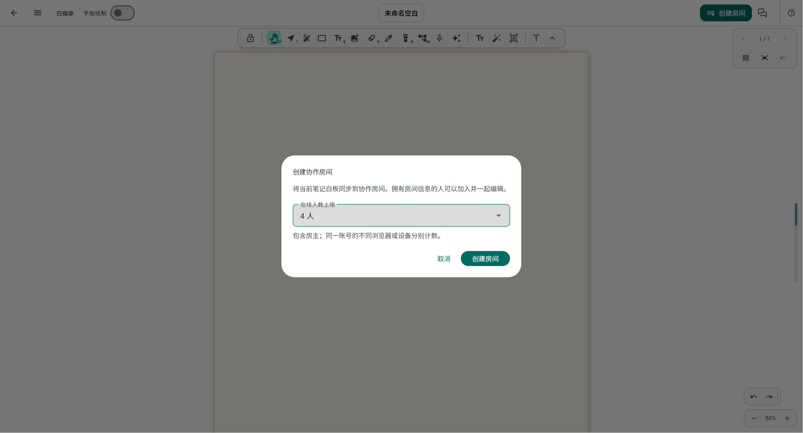
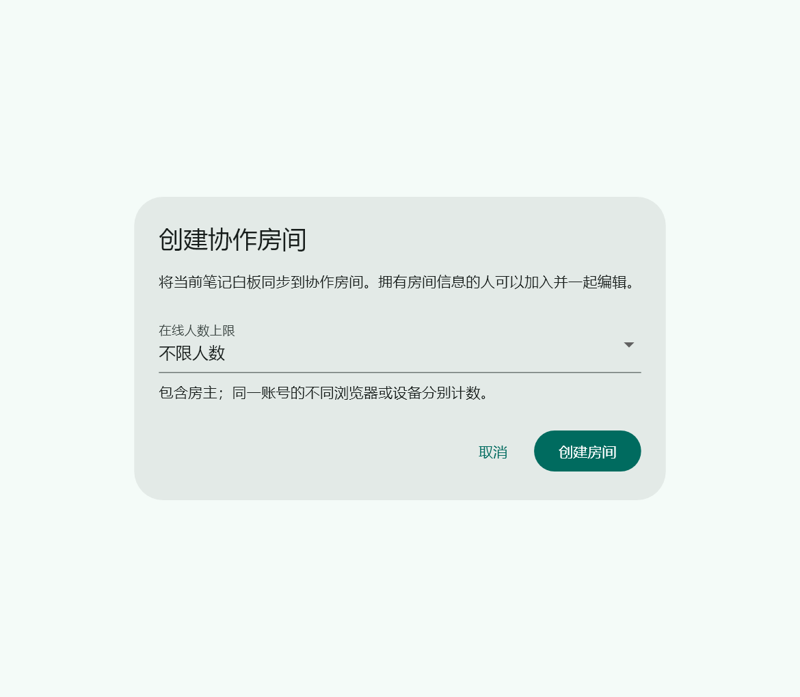
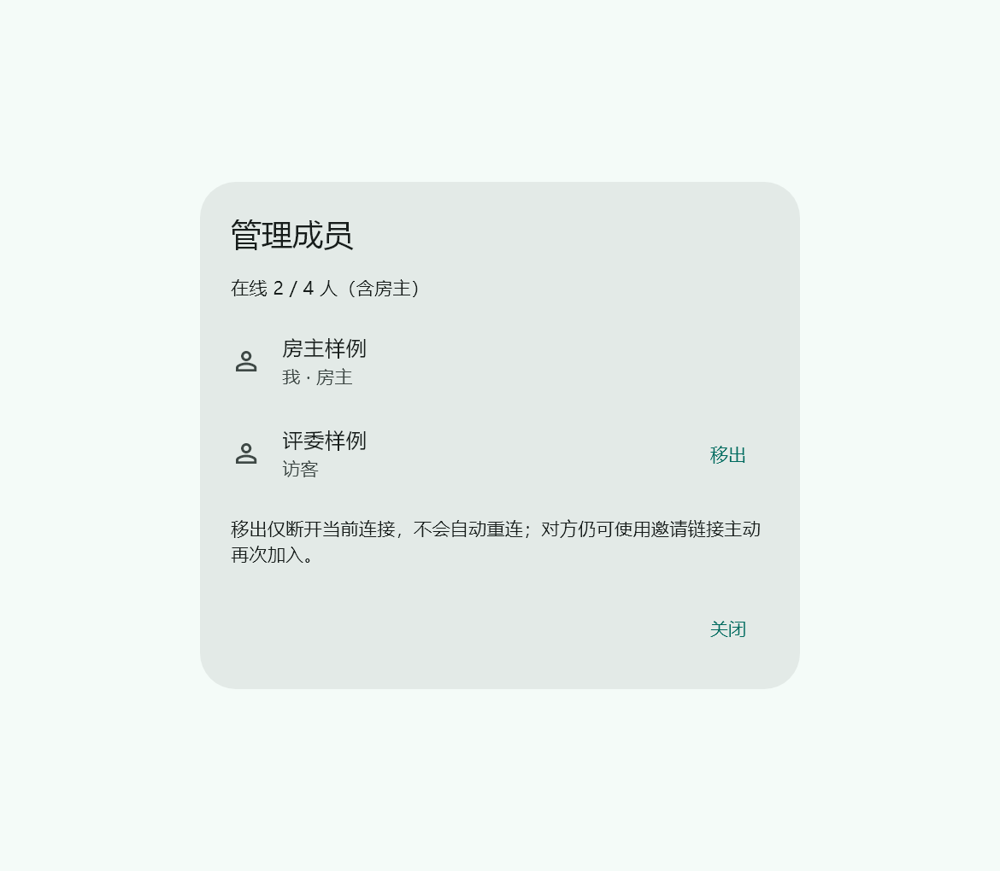

# 协作房间人数与成员管理验证

日期：2026-10-23。应用功能提交 `4e92510`，服务端功能提交 `0bd58e2`。对应 Issue #66，源码分支 `feature/collaboration-room-management`。

## 行为与边界

- 创建房间默认不限，可选 2/4/8/16/32 个在线连接，包含房主；同一账号的不同浏览器/设备分别计数。服务端接受 0 或 2–50，旧房间/缺字段默认不限。
- 限额在 Socket.IO 入房时原子检查，重复入房不重复计数，退出和断线释放名额。人数控制不进入笔画、光标或湿墨转发热路径。
- 房主从协作菜单打开“管理成员”，实时查看在线连接，确认后移出指定成员。服务端验证房主账号或独立 ownerKey，不使用元素创建者信息授权；不能移出服务端验证的房主连接。
- 移出撤销房间成员资格、离开 adapter 房间、发送原因并主动断开 Socket.IO。新客户端停止自动重连、取消后续快照、清理临时远端墨迹，保留已收到的画布，提供保存为本地笔记的选项。
- 移出仅针对当前连接，不做永久封禁，也不能撤回已下载的快照或密钥。对方仍可主动使用邀请链接再次加入。

## 软件验证

- 最终全量 `flutter test --no-pub`：**1863 通过、5 项既有跳过**；协作与完整白板流程的定向回归 178 项通过。新增的移出清理测试再验证了停止待发快照与本地画布保留。
- 最终 `flutter analyze --no-pub`：**No issues found**。
- `go test ./...`、`go vet ./...` 通过。真实 PostgreSQL 集成测试已启用，使用独立临时容器与专用 `room_management_test` 数据库，每项测试单独 schema；没有使用生产数据库。验证结束后临时容器和 SSH 隧道已停止。
- Go 集成覆盖旧 schema 幂等迁移并保留旧房间、创建重试不改变上限、8 个连接争抢最后一个名额、房主计数、重复入房、越权/跨房间/房主移出拒绝、移出事件确实送达、湿墨权限撤销、名额释放及房间仍保持有效。非法上限在访问存储前拒绝。
- 组件测试覆盖不限与取消结果的区别、选择上限、实时成员更新、移出确认/取消、失败重试、等待时禁用重复请求、关闭后迟到完成；真实组件在 360px 窄屏检查无溢出。
- Web release 和 Linux amd64 服务端二进制已成功构建。Web 本地 release 实际启动，经过“新建空白笔记 → 协作菜单 → 创建房间 → 选择 4 人”，页面显示正确，控制台错误 0；未按下创建确认，没有创建线上房间。

测试排障：本地忽略目录中存在旧 Go 探针快照，它仍调用旧 CreateRoom 签名并被 `go test ./...` 扫入。已完整保留到 `FlowMuse-App/build/room-management/live-ink-probe.saved`，未修改正式检查范围。首次接入曾为普通入房增加不必要的安全存储读取，定向回归发现后已删除；仅新建房主连接携带 ownerKey，普通访客入房保持原路径。

## 界面证据

本地 release 的真实白板创建入口（空白测试笔记，未创建线上房间）：

实际组件渲染的创建与成员管理预览。成员名称均为合成样例，未截图真实在线房间：

## 发布与回归边界

两端构建标识为 `4e92510`，显式使用生产 API/分享源，并开启湿墨分层和实时墨迹 V2。以下产物均在本地忽略目录 `FlowMuse-App/build/room-management/`，没有随 Git 提交：

| 产物 | 路径 | SHA-256 |
| --- | --- | --- |
| Web 主脚本 | `web/main.dart.js` | `ff15b42ce6aea2b550fb3b034478fca2219f423c8c0dbd426aec1da11012fead` |
| Android ARM64 | `flowmuse-room-management-4e92510-arm64.apk` | `abd1f6d303cebc557dc2d5c6f2d605de1c511f62ca6a43eda1dc8432b38ef89f` |
| Linux amd64 服务端 | `flowmuse-collab-server-linux-amd64` | `93455312de4248b16c6459c5a3f3452fa7f20720327e2a286e3fbc94719bdca4` |

APK 为 195646563 字节，签名与已装扫码包一致，ARM64 Flutter 引擎未变化，AOT 与 Web 主脚本中的构建标识已核对。完整回执为本地 `artifact-receipt.json`。

本轮完成代码和软件验证，尚未合并到 main、尚未将两项管理功能部署正式后端/Web 或安装到平板。正式环境与平板目前仍为上一轮扫码版本。

发布需先更新后端，使幂等扩展生效，再更新 Web 和安卓。新前端要求服务端回显创建上限，旧后端静默忽略时会明确失败，不显示虚假的限制成功。旧客户端继续可进不限房间，受新后端人数限制，也会被服务端强制移出；它不具备新的管理界面和移出原因弹窗。

真实安卓/Web 多设备管理、反复断网重连、多人长时间书写尚需验收；本轮不承诺提升书写同步时延，没有改动既有笔画合并、ACK、补同步或 Live Ink V2 算法。
